# NASE Gönderim Taslağı


**Durum: İNCELEME BEKLİYOR · Türkçe gövde; dil seçimi danışman teyidine tabidir.** Bu dosya [ders makalesinden](outline.md) `python -B tools/prepare_paper_assets.py --nase` ile türetilir; bağımsız bir sonuç veya yöntem kaynağı değildir.


**Biçim ve gönderim kontrol notu:** [Resmî NASE kuralları](https://dergipark.org.tr/en/pub/nase/writing-rules) 25.11.2026 tarihinde kontrol edildi. DOCX şablonuna aktarımda tek sütun, 10 pt Times New Roman, 1.15 satır aralığı ve 2.5 cm kenar boşluğu uygulanmalıdır. Başlık 12 pt; özet, anahtar kelimeler ve kaynakça 9 pt; abstract 150–300 kelime, anahtar kelimeler 5–8 adet olmalıdır. Yazar soyadları büyük harfle; her yazar için kurum/fakülte/bölüm, e-posta ve ORCID gereklidir. APA 6 yazar–yıl atıfları ve alfabetik kaynakça korunmalıdır. Şekil ve tablolar metinde anılmalı, denklemler ardışık numaralarla Word denklem düzenleyicisine aktarılmalıdır. Markdown dosyası sayfa/font ayarlarını uygulamaz; resmî şablona son aktarım ve görsel kontrol **İNCELEME BEKLİYOR**. Danışman Türkçe/İngilizce seçimini kesinleştirmeli ve gönderim günü kurallar yeniden kontrol edilmelidir.


## Başlık

**Türkçe başlık:** Permütasyon Akış Tipi Çizelgelemede Beş Meta-Sezgisel Algoritmanın Eşit Değerlendirme Bütçesiyle Makespan Açısından Karşılaştırılması

**English title:** Comparing Five Metaheuristic Algorithms for Permutation Flow Shop Makespan under Equal Evaluation Budgets

## Yazar Künyeleri

Ad-soyad ve ortak kurum bilgileri Bilal tarafından 25.11.2026 tarihinde teyit edilmiştir. Danışman 1., takım lideri 2. sıradadır; diğer yazarların nihai sırası gerçek katkı puanına ve danışman onayına tabidir. E-posta ve ORCID bilgileri henüz teyit edilmemiştir.

| Rol | Ad ve soyad | Üniversite / fakülte / bölüm | E-posta | ORCID |
| --- | --- | --- | --- | --- |
| 1 / danışman | Abdullah ELEN | Ortak kurum¹ | [TEYİT BEKLİYOR] | [TEYİT BEKLİYOR] |
| 2 / takım lideri | Muhammed YILMAZ | Ortak kurum¹ | [TEYİT BEKLİYOR] | [TEYİT BEKLİYOR] |
| Katkıya göre / algoritmalar | Burak Münteha ELLİK | Ortak kurum¹ | [TEYİT BEKLİYOR] | [TEYİT BEKLİYOR] |
| Katkıya göre / model | Şeref TEKMAN | Ortak kurum¹ | [TEYİT BEKLİYOR] | [TEYİT BEKLİYOR] |
| Katkıya göre / deney ve istatistik | Tarık KARAOĞLAN | Ortak kurum¹ | [TEYİT BEKLİYOR] | [TEYİT BEKLİYOR] |
| Katkıya göre / makale | Bilal Erkan TAŞKIN | Ortak kurum¹ | [TEYİT BEKLİYOR] | [TEYİT BEKLİYOR] |

¹ Tüm yazarların ortak kurumu: Yazılım Mühendisliği Bölümü, Mühendislik ve Doğa Bilimleri Fakültesi, Bandırma Onyedi Eylül Üniversitesi, Balıkesir, Türkiye. Sorumlu yazarın nihai onayı ve iletişim adresi [TEYİT BEKLİYOR].

## Özet

Permütasyon akış tipi çizelgelemede ortak iş sırasının seçimi, üretim çizelgesinin son tamamlanma zamanını doğrudan etkiler. Bu çalışma, sürekli arama yöntemlerinin aynı çözüm gösterimi ve eşit amaç değerlendirme bütçesi altında sunduğu çözüm kalitesini ve koşular arası kararlılığı incelemektedir. Diferansiyel Evrim, Parçacık Sürü Optimizasyonu, Dung Beetle Optimizer, RIME ve Newton–Raphson Based Optimizer, Taillard koleksiyonunun yirmi iş içeren üç örneğinde karşılaştırılmıştır. Beş, on ve yirmi makineli örneklerde sırasıyla 20000, 30000 ve 40000 amaç değerlendirmesi kullanılmıştır. Her yöntem ve örnek eşleşmesi otuz bağımsız koşuyla değerlendirilmiş, toplam 450 koşu ve 13500000 amaç değerlendirmesi kaydedilmiştir. Gerçek değerli anahtarlar kararlı sıralamayla permütasyona dönüştürülmüş; klasik Nawaz–Enscore–Ham sezgiseli ayrıca deterministik referans olarak ele alınmıştır. Kaydedilen en iyi tamamlanma süreleri sırasıyla 1288, 1586 ve 2318 olmuştur. İlk örnekte Diferansiyel Evrim, ikinci örnekte RIME en iyi koşuyu üretmiş; üçüncü örnekte Diferansiyel Evrim ile Parçacık Sürü Optimizasyonu aynı minimuma ulaşmıştır. İlk örnekte bütün yöntemlerin medyanı 1297 iken klasik referansın sonucu 1286 olmuştur. Holm düzeltmeli sıra toplamı karşılaştırmaları ikinci örnekte RIME lehine farklar göstermiş, üçüncü örnekte Diferansiyel Evrim ile RIME arasında anlamlı fark göstermemiştir. Bağımsız çizelge hesabı seçili çözümlerin tamamlanma sürelerini ve çakışmasızlığını doğrulamıştır. Sonuçlar, tek en iyi koşunun dağılım ve kararlılık ölçülerinin yerini alamayacağını göstermektedir. Çıkarımlar üç örnek ve sabit parametre düzeniyle sınırlıdır; bütün çizelgeleme problemleri için genel üstünlük iddiası taşımamaktadır.

**Anahtar Kelimeler:** Random-key kodlama; Taillard örnekleri; Kararlı sıralama; Holm düzeltmesi; Koşular arası kararlılık; Yeniden üretilebilirlik

## Abstract

Selecting a common job order in permutation flow shop scheduling directly affects the completion time of the production schedule. This study examines solution quality and variability across runs when continuous search methods share a representation and equal objective evaluation budgets. Differential Evolution, Particle Swarm Optimization, Dung Beetle Optimizer, RIME, and Newton–Raphson Based Optimizer are compared on three Taillard instances containing twenty jobs. The instances with five, ten, and twenty machines receive 20000, 30000, and 40000 evaluations per run, respectively. Thirty independent runs for every method and instance produce 450 runs and 13500000 evaluations. Real valued keys are converted into permutations using stable sorting, while the deterministic Nawaz–Enscore–Ham heuristic provides a separate classical baseline. The best recorded completion times are 1288, 1586, and 2318. Differential Evolution provides the best run on the first instance, RIME on the second, and Differential Evolution and Particle Swarm Optimization share the minimum on the third. All methods have a median of 1297 on the first instance, where the classical baseline obtains 1286. Holm adjusted rank sum comparisons favor RIME on the second instance but find no significant difference between Differential Evolution and RIME on the third. Independent schedule reconstruction verifies completion times and absence of overlaps. These findings distinguish isolated best runs from distributional performance; conclusions remain restricted to three instances and the fixed parameter configuration.

**Keywords:** Random-key encoding; Taillard instances; Stable sorting; Holm correction; Run variability; Reproducibility

## 1. Introduction

Permütasyon akış tipi çizelgeleme probleminde (PFSP), her iş aynı makine rotasını izler ve bütün makinelerde ortak bir iş sırası uygulanır. Klasik modelde bir makine aynı anda en fazla bir işi işler. Başlayan bir işlem kesilmez ve her iş, bir sonraki makineye geçmeden önce mevcut işlemini tamamlar. Belirli bir iş sırası için her işlemin en erken başlangıcı, makinenin bir önceki işi bitirmesine ve ilgili işin önceki makinedeki işlemini tamamlamasına bağlıdır. Bu çalışmanın amacı, son işin son makinedeki tamamlanma anı olan makespan’i (Cmax) en aza indirmektir. İşlerin tamamlanma zamanlarının toplamı (ΣCj) ayrı bir amaç fonksiyonudur. ([Taillard, 1993](#ref-L01))

İş sayısı arttıkça olası sıraların sayısı faktöriyel olarak büyür. Bir sıranın çizelgesini hesaplamak için her iş ve makine çifti bir kez ziyaret edilebilir. Ancak bu hesaplama kolaylığı, bütün sıraların aranmasını uygulanabilir kılmaz. Makespan minimizasyonlu permütasyon akış tipi çizelgelemenin genel biçimi NP-zordur. Gmys’in Taillard örnekleri üzerindeki kesin dal-sınır çalışması, bazı örneklerde optimumun kanıtlanması ile bazı örneklerde bilinen üst sınırın iyileştirilmesini ayrı başarılar olarak raporlar. Bu ayrım, deneyde elde edilen bir çizelgenin kalitesini yorumlamak için önemlidir. Sezgisel bir yöntemle elde edilen çizelge, problem için uygulanabilir bir üst sınır sağlar. ([Gmys, 2022](#ref-L09)); ([Cáceres-Gelvez et al., 2026](#ref-L12))

Nawaz, Enscore ve Ham’ın NEH sezgiseli, işleri kısmi çizelgeye sırayla ekleyen klasik bir yapıcı yöntemdir. Güncel çalışmalar farklı hesaplama düzenleri kullanır. Örneğin Li ve arkadaşları, çizelgeleme politikasını uzman çözümlerinden öğrenen grafik tabanlı bir yöntemi Taillard ve VRF örneklerinde değerlendirir. Tsiftsoglou ve arkadaşları ise ortak kodlama ve yerel iyileştirme bileşenleriyle hibrit stokastik yöntemleri karşılaştırır. İlk çalışma değerlendirmede makespan farkı ve çalışma süresini, ikincisi ise örnek başına tekrarlı koşuları ve göreli hata ölçümlerini kullanır. Bu tasarımlar, karşılaştırmada yöntemin yanında temsilin, ölçütün ve deney koşullarının da açıkça belirtilmesi gerektiğine örnektir. ([Nawaz et al., 1983](#ref-L02)); ([Tsiftsoglou et al., 2026](#ref-L10)); ([Li et al., 2024](#ref-L11))

Bu çalışmada Diferansiyel Evrim (DE), Parçacık Sürü Optimizasyonu (PSO), Dung Beetle Optimizer (DBO), RIME ve Newton–Raphson Based Optimizer (NRBO) sürekli değerli adaylar üzerinden çalıştırılmıştır. Bean’in random-key gösteriminden hareketle her işe bir gerçek değerli anahtar atanmış ve anahtarlar artan sırada sıralanarak iş permütasyonu elde edilmiştir. Eşit anahtarlarda başlangıçtaki iş indeksi sırasını koruyan kararlı sıralama kullanılmıştır. Böylece her aday her işi tam bir kez içeren bir sıraya dönüşmüş ve bütün algoritmalar aynı çizelge değerlendirme kuralını kullanmıştır. Aynı göreli sıralamayı koruyan farklı anahtar vektörleri aynı çizelgeye karşılık gelebilir. NEH, beş stokastik yöntem için ayrı bir klasik referans sağlamıştır. ([Bean, 1994](#ref-L03)); ([Storn & Price, 1997](#ref-L04)); ([Kennedy & Eberhart, 1995](#ref-L05)); ([Xue & Shen, 2023](#ref-L06)); ([Su et al., 2023](#ref-L07)); ([Sowmya et al., 2024](#ref-L08))

Araştırma sorusu, beş yöntemin aynı örnek ve aynı amaç fonksiyonu değerlendirme (FE) bütçesi altında hangi Cmax kalitesine ve koşular arası kararlılığa ulaştığıdır. Eşit iterasyon sayısı, yöntemler bir iterasyonda farklı sayıda aday değerlendirdiğinde farklı arama bütçeleri doğurabilir. Örnek başına ortak FE sınırı, karşılaştırılan yöntemlerin amaç fonksiyonuna aynı sayıda başvuru hakkına sahip olmasını sağlar. Başlangıç popülasyonundaki adayların değerlendirmeleri de bu sınıra dahildir. Eşit FE sınırı altında çalışma süreleri, çözümleme ve algoritma işlemlerinin maliyetine bağlı olarak farklılaşabilir. Bu nedenle FE ve çalışma süresi ayrı kaydedilmiştir. Bu tercih, kaynaklarda görülen farklı karşılaştırma tasarımları arasından bu deneyin sorusuna uygun bir ölçü seçer. ([Taillard, 1993](#ref-L01)); ([Tsiftsoglou et al., 2026](#ref-L10)); ([Li et al., 2024](#ref-L11))

Deney, Taillard’ın sırasıyla 20×5, 20×10 ve 20×20 boyutlarındaki ta001, ta011 ve ta021 örneklerini kullanmıştır. Ekip protokolünde örnek başına FE sınırları sırasıyla 20.000, 30.000 ve 40.000 olarak belirlenmiştir. Her algoritma ve örnek eşleşmesi için otuz bağımsız koşu yürütülmüştür. Bu bütçeler ve tekrar sayısı, Taillard makalesinin önerisi değil, projenin deney tasarımıdır. En iyi ve medyan Cmax, koşular arası yayılım ve örneğin kaynakta verilen referans değerine göre yüzde sapma raporlanmıştır. Tekrarlar aynı örnekteki stokastik değişkenliği ölçer. Çalışmanın ampirik kapsamı seçilen üç örnekle sınırlıdır. Protokolün amacı, bu örneklerde ulaşılan çözüm kalitesini ve kararlılığı yeniden incelenebilir bir deney kaydıyla ortaya koymaktır. ([Taillard, 1993](#ref-L01))

Metnin devamında literatürün erişim sınırları, ortak model ve yöntemler, deney sonuçları ve çalışmanın sınırlılıkları sunulmaktadır.

### 1.1. Literatür ve araştırma sorusu

Tarama, sekiz temel yöntem/temsil kaynağı ve dört güncel PFSP çalışmasını kapsayan hedefli incelemedir; sistematik tarama veya ilk karşılaştırma iddiası değildir. Tablo 1 kaynakların bu deneydeki işlevini özetler. Ayrıntılı künye, bütçe ve erişim kayıtları [literatür matrisi](literature_matrix.md), [kaynak denetimi](source_audit.md) ve [araştırma soruları](gap_analysis.md) içinde korunmuştur. Çalışma, eşit FE altında kalite ve kararlılık sorusunu yanıtlar; permütasyon tekrarları ve yerel aramanın nedensel katkısı ölçülmemiştir.

**Tablo 1. Literatür kapsamı ve karşılaştırılabilirlik sınırları.**

| Kaynak | Çalışmadaki işlev / erişim sınırı |
| --- | --- |
| ([Taillard, 1993](#ref-L01)) | Benchmark ve referans sınırlar; özgün iterasyon bütçesi proje FE bütçesi değildir. |
| ([Nawaz et al., 1983](#ref-L02)) | İş önceliği ve ekleme sezgiseli; özgün deney ayrıntılarına tam metin erişimi yoktur. |
| ([Bean, 1994](#ref-L03)) | Gerçek değerli anahtar temsili; stable argsort proje kararıdır. |
| ([Storn & Price, 1997](#ref-L04)) | Vektör farkı mutasyonu, çaprazlama ve seçim; bu çalışmada DE/rand/1/bin. |
| ([Kennedy & Eberhart, 1995](#ref-L05)) | Kişisel ve sürü en iyisine dayanan hareket; atalet varyantı ayrıca kaynaklandırılır. |
| ([Xue & Shen, 2023](#ref-L06)) | Yuvarlama, dans, üreme, beslenme ve çalma; özgün tam metin açılmamıştır. |
| ([Su et al., 2023](#ref-L07)) | Soft-rime, hard-rime ve açgözlü seçim; yazar kopyası ve kodu erişilebilir. |
| ([Sowmya et al., 2024](#ref-L08)) | NRSR ve TAO; yazar kodu eşleştirilmiş, özgün denklem numaraları doğrulanamamıştır. |
| ([Gmys, 2022](#ref-L09)) | Kesin çözüm ile daha iyi üst sınır farklı başarılardır. |
| ([Tsiftsoglou et al., 2026](#ref-L10)) | Hibrit arama; tutarsız kaynak sayıları sonuç kanıtı yapılmaz. |
| ([Li et al., 2024](#ref-L11)) | Grafik tabanlı taklit öğrenmesi; eğitim maliyeti eşit FE düzenine doğrudan taşınamaz. |
| ([Cáceres-Gelvez et al., 2026](#ref-L12)) | MIP tabanlı komşuluk araması; zaman bütçesi FE bütçesine eşit değildir. |

NEH ayrı yapıcı baseline olarak değerlendirilir. Hibrit ve öğrenmeye dayalı çalışmalar farklı bütçe, eğitim ve iyileştirme bileşenleri nedeniyle bu deneyin sayısal rakipleri değildir. Kaynak tablolarındaki tutarsızlıklar düzeltilmiş gibi yeniden kullanılmamıştır. Kaynak erişimi ile uygulama doğrulaması farklı kanıt katmanlarıdır.

## 2. Materials and Methods

Çalışma, deterministik PFSP değerlendirmesi ile stokastik arama yöntemlerini ayırır. Model ve temsil Şeref'in, PSO ve deney düzeni Tarık'ın, DBO/NRBO Burak'ın, RIME Muhammed'in yöntem belgelerine dayanır. Deney kayıtları değiştirilmeden kullanılmıştır.

**Çalışma kümesi ve veri toplama süreci:** Üç sabit Taillard matrisi üzerinde hesaplamalı deney yürütülmüştür; insan veya hayvan katılımcısı yoktur. Ham koşular sabit sürümde üretilmiş, manifest ve doğrulama kaydıyla ilişkilendirilmiştir.

**Yapay zekâ kullanım açıklaması:** ChatGPT/Codex (OpenAI), kaynak tarama desteği, metin düzenleme ve birleştirme, mevcut sonuçların betikle aktarılması, doğrulama komutlarının yürütülmesi ve bağımsız verifier çıktısından Gantt çizim kodunun hazırlanmasında kullanılmıştır. Deney sayıları, kaynak kimlikleri ve yazar bilgileri üretken metinle uydurulmamıştır. Bilimsel yorumların, kaynak erişim sınırlarının, kodun ve tüm beyanların nihai doğrulama ve sorumluluğu insan yazarlardadır. Diğer ekip araçları, kullanım kapsamları ve sürümleri [TEYİT BEKLİYOR]; bu kayıt insan bağımsız incelemesi yerine geçmez.

### 2.1. Problemin Tanımı ve Matematiksel Modeli

Permütasyon Akış Tipi Çizelgeleme Probleminde (PFSP) `n` iş, aynı `m` makineyi `M1,...,Mm` sırasıyla ziyaret eder. Her makine aynı anda yalnız bir işi işler, bir iş aynı anda yalnız bir makinede bulunur, işlemler bölünmez ve bütün makinelerde ortak iş sırası kullanılır. Karar değişkeni işlerin permütasyonudur:

**Denklem (1).**

$$
\pi=(\pi_1,...,\pi_n).
\tag{1}
$$

`p_{j,k}`, j işinin k makinesindeki işlem süresini göstersin. Sınır değerleri `C_{0,k}=0` ve `C_{i,0}=0` olmak üzere tamamlanma zamanları

**Denklem (2).**

$$
C_{i,k}=\max\{C_{i-1,k},C_{i,k-1}\}+p_{\pi_i,k}
\tag{2}
$$

ile hesaplanır. Amaç, son işin son makinedeki tamamlanma zamanını, yani makespan değerini en aza indirmektir:

**Denklem (3).**

$$
\min_\pi C_{max}(\pi)=C_{n,m}.
\tag{3}
$$

Bu amaç toplam tamamlanma süresi `ΣC_j` değildir.

([Taillard, 1993](#ref-L01)) İşlem süreleri job-major tutulur. Referanslar [metadata](../data/taillard/reference_solutions.json) içindeki 18.11.2026 erişim kaydına ve 03.06.2026 kaynak güncellemesine bağlıdır; optimum kanıtı veya yeni dünya rekoru iddiası yoktur.

### 2.2. Çözüm Gösterimi ve Kısıt Yönetimi

Beş meta-sezgisel algoritmanın tamamında ortak random-key gösterimi kullanılır:

**Denklem (4).**

$$
x=(x_1,...,x_n),\qquad x_i\in[0,1].
\tag{4}
$$

Sürekli vektör, artan anahtar sırasıyla iş permütasyonuna dönüştürülür:

**Denklem (5).**

$$
\pi=\operatorname{argsort}(x).
\tag{5}
$$

Uygulama eşit anahtarlarda deterministik davranmak için `np.argsort(..., kind="stable")` kullanır. Böylece bütün algoritmalar aynı temsil ve çözümleme mekanizmasına sahiptir.

Random-key çözümleyicisi her işi tam bir kez içeren permütasyon ürettiğinden normal optimizasyon akışında ek ceza kısıtı gerekmez. Bununla birlikte modelin `objective()` metodu doğrudan verilen permütasyonlarda uzunluk, indeks aralığı, tamsayı olma ve tekrarsızlık kontrollerini yapar. Algoritmalardan gelen anahtarlar değerlendirmeden önce ortak `[0,1]` sınırına kırpılır.

([Bean, 1994](#ref-L03)) Stable sıralama proje kararıdır. Aynı göreli anahtar sırası aynı permütasyona dönüşebilir; farklı gerçek vektörler farklı çizelge anlamına gelmez.

### 2.3. Karşılaştırılan Meta-Sezgisel Algoritmalar

Beş yöntem aynı random-key temsili ve Cmax değerlendirmesini kullanır. Bütün rastgele çekilişler `np.random.default_rng(seed)` kaynağından gelir. Başlatma dahil her objective değerlendirmesi bir FE sayılır; bütçe tur ortasında biterse döngü kesilir. Son kayıt `(max_fes, best_f)` olur. Dönüş sözlüğü `best_x`, `best_f`, `history`, `n_fes`, `time` alanlarını içerir. NEH ayrı deterministik baseline'dır; beşli kümeye dahil değildir. Hazır meta-sezgisel kütüphane, gizli yerel arama veya NEH başlatması bu karşılaştırmaya eklenmemiştir.

NEH, işleri bütün makinelerdeki toplam işlem süreleri azalan sırada önceliklendirir; her yeni işi kısmi sıranın bütün konumlarına ekleyerek en küçük kısmi Cmax veren konumu tutar. Proje tie-break'i eşit toplamda düşük iş indeksi, eşit ekleme Cmax değerinde en erken konumdur. Her benchmark için bir deterministik sonuç raporlanır; 30 tekrarlı stokastik deney yapılmaz. ([Nawaz et al., 1983](#ref-L02))

### 2.3.1. Diferansiyel Evrim (DE)

DE/rand/1/bin ([Storn & Price, 1997](#ref-L04)) temelinde uygulanmıştır. Aşağıdaki açıklama [sahip yöntem metninden](method_de.md) birleştirilmiştir.

**Başlatma**

PFSP'deki her aday random-key vektörü olarak tutulur:

**Denklem (6).**

$$
x_i=(x_{i1},...,x_{iD}),\qquad x_{ij}\in[0,1].
\tag{6}
$$

Başlangıç popülasyonu `np.random.default_rng(seed)` ile bağımsız uniform dağılımdan üretilir. Problem boyutu üç zorunlu benchmarkta da `D=20` olduğundan varsayılan popülasyon büyüklüğü `NP=5D=100`dür. Kaynak çalışma NP için yaklaşık `3D–10D` aralığını pratik bir başlangıç kuralı olarak verir; proje `5D` seçimini deney öncesinde sabitler.

**Mutasyon**

Her hedef vektör `x_i,G` için, hedef indeksinden ve birbirinden farklı üç indeks `r1,r2,r3` seçilir:

**Denklem (7).**

$$
v_{i,G+1}=x_{r1,G}+F(x_{r2,G}-x_{r3,G}).
\tag{7}
$$

Projede `F=0.5` kullanılır. Mutant vektör `[0,1]^D` sınırına kırpılır.

**Binom çaprazlama**

Her boyut için mutant bileşenin seçilme olasılığı `CR`'dir. En az bir mutant bileşenin aktarılmasını garanti etmek için rastgele `j_rand` boyutu zorunlu seçilir:

**Denklem (8).**

$$
u_{ij,G+1}=
\begin{cases}
v_{ij,G+1}, & rand_j\le CR\ \text{veya}\ j=j_{rand},\\
x_{ij,G}, & \text{aksi halde}.
\end{cases}
\tag{8}
$$

Projede `CR=0.9` kullanılır.

**Seçim ve nesil semantiği**

Deneme vektörü hedef vektörden daha iyi veya eşit amaç değerine sahipse bir sonraki nesle geçer:

**Denklem (9).**

$$
x_{i,G+1}=
\begin{cases}
u_{i,G+1}, & f(u_{i,G+1})\le f(x_{i,G}),\\
x_{i,G}, & \text{aksi halde}.
\end{cases}
\tag{9}
$$

Uygulama **generational** DE'dir: mutasyon ve çaprazlama sırasında bütün ebeveyn okumaları `X_gen` adlı değişmez G neslinden yapılır. Böylece bir hedefin güncellenmesi aynı nesildeki sonraki hedeflerin mutant üretimini etkilemez.

**PFSP uyarlaması ve FE bütçesi**

DE sürekli vektör üzerinde çalışır; amaç fonksiyonu çağrısında ortak random-key çözümleyicisi kararlı `argsort` ile iş permütasyonunu üretir. Mutasyon sonrası sınır dışı değerler `[0,1]` aralığına kırpılır.

Başlangıç popülasyonundaki değerlendirmeler dahil her `problem.evaluate()` çağrısı bir FE olarak sayılır. Ana deneylerde bütçe örneğe göre 20.000 / 30.000 / 40.000 FE'dir. Bütçe bir neslin ortasında sona ererse o ana kadar tamamlanan seçimler korunur ve `n_fes == max_fes` koşulu sağlanır.

Etkin parametreler Tablo 2 ile sabittir. `X_gen`, aynı nesilde önce kabul edilmiş adayların sonraki ebeveyn okumalarını değiştirmesini önler.

### 2.3.2. Parçacık Sürü Optimizasyonu (PSO)

Temel PSO ([Kennedy & Eberhart, 1995](#ref-L05)) ile, atalet ağırlığı ise ayrıca ([Shi & Eberhart, 1998](#ref-P98)) ile kaynaklandırılır. Ataletin tanıtılması yayıncı özetinden doğrulanmıştır. Doğrusal FE zamanlaması proje uyarlamasıdır; 1995 özgün deneyi gibi sunulmaz.

**Başlatma**

Her parçacık D boyutlu bir random-key konumu ve hız vektörü taşır. Başlangıç konumları `U(lb, ub)`, hızları `U(−v_max, v_max)` dağılımından bileşen bazında çekilir. Hız sınırı `v_max = v_frac × (ub − lb)` olarak hesaplanır. Bütün çekilişler `np.random.default_rng(seed)` ile yapılır. Başlangıç değerlendirmeleri FE bütçesine dahildir. Değerlendirilen başlangıç konumları kişisel en iyileri oluşturur. Sürü en iyisi, bunların en düşük amaç değerine sahip olanıdır.

**Hız ve konum güncellemesi**

Her dış turun başında atalet ağırlığı, o ana kadar tüketilen FE sayısıyla hesaplanır ve tur boyunca sabit kalır. İlk ağırlık başlangıç değerlendirmelerinden sonra hesaplanır.

**Denklemler (10)–(13).**

```text
w = w_max − (w_max − w_min) × fes / max_fes    (10)
v_i ← w × v_i + c1 × r1 × (pbest_i − x_i) + c2 × r2 × (gbest − x_i)    (11)
v_i ← clip(v_i, −v_max, v_max)    (12)
x_i ← clip(x_i + v_i, lb, ub)    (13)
```

Her parçacık güncellemesinde `r1` ve `r2` birbirinden bağımsız D boyutlu uniform vektörler olarak çekilir. Çarpımlar bileşen bazındadır. Kişisel en iyi ve sürü en iyisi kesin iyileşmede güncellenir. Tur içinde iyileşen sürü en iyisi, sonraki parçacıklar tarafından kullanılabilir. Ortak PFSP modeli anahtarları kararlı sıralamayla iş permütasyonuna dönüştürür ve Cmax değerini hesaplar.

N=30, w_max=0.9, w_min=0.4, c1=c2=2.0 ve v_frac=0.2 kullanılır. [Sahip yöntem belgesi](method_pso.md) ile Tablo 2 tutarlıdır.

### 2.3.3. Dung Beetle Optimizer (DBO)

DBO ([Xue & Shen, 2023](#ref-L06)) N=30 için 6 yuvarlayan, 6 yumurtlayan, 7 küçük ve 11 hırsız birey kullanır. Yuvarlama/dans kararı tur başında verilir. Yuvarlama önceki konum ve en kötüye uzaklığı, dans tanjant hareketini kullanır. Yumurtlama yerel en iyi, diğer iki rol global en iyi çevresinde arar. Uygulama kuralları şöyledir:

**Denklemler (14)–(20).**

```text
x_new = x + α×k×x_previous + b×abs(x−X_worst)    (14)
x_dance = x + tan(θ)×abs(x−x_previous)    (15)
L_star = max(X_star×(1−R),lb); U_star=min(X_star×(1+R),ub)    (16)
B_new = X_star + b1×(B−L_star) + b2×(B−U_star)    (17)
L_b = max(X_best×(1−R),lb); U_b=min(X_best×(1+R),ub)    (18)
x_small = x + C1×(x−L_b) + C2×(x−U_b)    (19)
x_thief = X_best + S×g×(abs(x−X_star)+abs(x−X_best))    (20)
```

b1,b2 uniform vektör, C1 normal skaler, C2 uniform vektör, g normal vektördür. R=1−fes/max_fes yuvarlama grubundan sonra hesaplanır. θ tamsayı dereceyle seçilir; 90°/180° durumunda konum değiştirilmez. Bu tercih yazar kodunun koruma satırını ardından tanjantla ezmesinden bilinçli sapmadır ve erişilen yöntem anlatımını izler. α=−1 olasılığı 0.1, yuvarlama olasılığı 0.9, k=0.1, b=0.3 ve S=0.5'tir. Yeni konum daha iyiyse tutulur; bölgesel ve ortak sınırlar uygulanır.

**Erişim sınırı:** Özgün yayıncı PDF'si doğrudan okunmamıştır. Denklem gövdeleri erişilen yöntem kaynakları ve yazar koduyla eşlenmiştir. Üst sınırdaki `(1+R)` yazar kodunu izler; özgün PDF baskısı doğrulanmış sayılmaz. FE tabanlı R proje uyarlamasıdır. [Yöntem notu](method_dbo_nrbo.md) ve [güncel kabul sınırı](../docs/quality_status.md) korunmuştur. Buradaki eşitlikler özgün makalenin doğrudan transkripsiyonu olarak sunulmaz.

### 2.3.4. RIME

RIME ([Su et al., 2023](#ref-L07)) soft-rime, hard-rime ve açgözlü seçim mekanizmalarını kullanır. Yazar kopyası ve kamuya açık kodla çapraz kontrol [sahip yöntem metninde](method_rime.md) kayıtlıdır.

1. **Başlatma:** N ajan [lb, ub] içinde uniform örneklenir.
2. **Soft-rime search:** Yazar kodundaki RimeFactor ile en iyi çözüm çevresinde yeni aday oluşturulur.
3. **Hard-rime puncture:** normalize edilmiş uygunluk oranına göre bazı boyutlar doğrudan global best değerine taşınır.
4. **Positive greedy selection:** Yeni aday yalnız mevcut ajandan daha iyiyse popülasyona alınır.
5. **Boundary absorption:** Proje sözleşmesine uygun olarak adaylar değerlendirmeden önce `np.clip` ile [lb, ub] aralığına alınır.

**FE-bütçeli uyarlama**

Özgün RIME uygulaması iterasyon sayısını kullanır; ders projesi ise kesin FE bütçesi ister. Bu nedenle:
- başlangıç değerlendirmeleri FE sayılır,
- sonraki her ajan değerlendirmesi bir FE sayılır,
- son popülasyon turu bütçe ortasında kesilebilir,
- ilerleme oranı, kalan bütçeye sığan tam/kısmi popülasyon turlarının sayısına göre `iteration / max_iter` olarak hesaplanır,
- `n_fes == max_fes` zorunludur.

Bu dönüşüm, yazar kodundaki arama mekanizmasını korurken dersin eşit FE karşılaştırması şartını sağlar. İterasyon tabanlı özgün deney sonuçlarıyla birebir performans eşdeğerliği iddia edilmez.

**Varsayılan parametreler**

- `pop_size = 30`: ekipte diğer popülasyon tabanlı yöntemlerle ortak deney ölçeği için kullanılır.
- `w = 5`: yazarın kamuya açık MATLAB kodundaki soft-rime parametresidir.

Kullanılan değerler deney manifestindeki etkin parametrelerle aynıdır.

Bu deneyde N=30 ve w=5 sabittir. `max_iter=ceil((max_fes−N)/N)` ile tam/kısmi tur sayısı belirlenir; ilerleme `iteration/max_iter` olur. Böylece RIME doğrudan `fes/max_fes` kullanan diğer zamanlamalardan ayrılır.

### 2.3.5. Newton-Raphson-Based Optimizer (NRBO)

NRBO ([Sowmya et al., 2024](#ref-L08)) NRSR ve TAO bileşenlerini kullanır. NRSR, konum farklarıyla kurulan türevsiz arama adımıdır; ayrık PFSP amaç fonksiyonunun analitik türevi hesaplanmaz. Aşağıdaki eşitlikler yazar koduyla eşlenen uygulama tanımıdır; özgün makale denklem numaraları kullanılmamıştır:

**Denklemler (21)–(30).**

```text
ΔX = u_vector × abs(X_best−X)    (21)
ρ = u1×(X_best−X) + u2×(X_r1−X_r2)    (22)
N0 = z1×(X_best−X_worst)×ΔX / (2×(X_best+X_worst−2×X))    (23)
Xa = X−N0+ρ; m = mean_dimensions(Xa+X)    (24)
yp = r1×(m+r1×ΔX); yq = r2×(m−r2×ΔX)    (25)
NRSR = z2×(yp−yq)×ΔX / (2×(yp+yq−2×X))    (26)
X1 = X−NRSR+ρ; X2 = X_best−NRSR+ρ    (27)
δ = (1−2×fes/max_fes)^5; X3 = X−δ×(X2−X1)    (28)
X_new = a1×(a1×X1+(1−a2)×X2)+(1−a2)×X3    (29)
X_TAO = base+θ1×(μ1×X_best−μ2×X) +θ2×δ×(μ1×mean_population(X)−μ2×X)    (30)
```

z1,z2 normal skalerlerdir. a1,a2 her boyut için bu sırayla çekilir. TAO, DF=0.6 olasılığıyla uygulanır; base, μ1<0.5 ise X_new, aksi halde X_best'tir. β eşit olasılıklı sıfır/bir olmak üzere μ1=3βu+(1−β), μ2=βu+(1−β); θ1∈U(−1,1), θ2∈U(−0.5,0.5). İlk m boyut ortalaması skaler, TAO ortalaması popülasyon vektörüdür. N=30'dur. δ turun başında hesaplanır, ikinci yarıda negatif olur. Açgözlü kabul ve hemen güncellenen en iyi çözüm kullanılır; başlangıç en kötüsü korunur.

Paydaya epsilon eklenmez. Yazar koduyla eşlenen `np.fmax/np.fmin` davranışı NaN'ı alt sınıra, sonsuz değerleri ilgili sınıra taşır; değerlendirmeye sonlu aday ulaşır. Bu, tekilliğin matematiksel yokluğu değildir. **Erişim sınırı:** özgün yayıncı tam metni ve denklem numaraları doğrulanamamıştır. NRSR/TAO eşleştirmesi resmî yazar koduna dayanır; FE tabanlı δ proje uyarlamasıdır. [Yöntem notu](method_dbo_nrbo.md) ve [kabul kapsamı](../docs/quality_status.md) korunmuştur.

### 2.4. Deney Düzeneği ve Performans Ölçütleri

Her algoritma ve örnek için 30 koşu vardır: 5×3×30=450 koşu, toplam 13500000 FE. Run k için seed=2025+k; seed listesi 2026–2055'tir. Aynı run numarasında yöntemler aynı seed değerini alır, fakat farklı çekiliş düzenleri aynı arama yolu demek değildir. NEH ayrı deterministik referanstır ve 450 koşuya dahil değildir.

**Tablo 2. Manifest ve parametre CSV'sinden etkin değerler.**

<!-- data:parameters -->
| Algoritma | Popülasyon | Etkin parametreler |
| --- | --- | --- |
| DBO | 30 | S=0.5; b=0.3; deviation_prob=0.1; k=0.1; roll_prob=0.9 |
| DE | 100 | CR=0.9; F=0.5 |
| NRBO | 30 | DF=0.6 |
| PSO | 30 | c1=2.0; c2=2.0; v_frac=0.2; w_max=0.9; w_min=0.4 |
| RIME | 30 | w=5 |
<!-- /data:parameters -->

**Tablo 3. Benchmark, referans ve ham dosya bütünlüğü.**

<!-- data:benchmarks -->
| Örnek | Boyut | Veri üretim tohumu | Referans | FE/koşu | SHA-256 |
| --- | --- | --- | --- | --- | --- |
| ta001 | 20×5 | 873654221 | 1278 | 20000 | `68164a1350ad2252e224b3fc36872ec65556f04cb6cd6914abaa455910867bf2` |
| ta011 | 20×10 | 587595453 | 1582 | 30000 | `e291f3f94885af40c9b9509cd9e939d66d4455d3611db55b42b3bfb801cf6656` |
| ta021 | 20×20 | 479340445 | 2297 | 40000 | `2fbd5446f94ebb5bfcf81fc0fcc4f5624294bfc4532c7f46354e76e832810f59` |
<!-- /data:benchmarks -->

Kaynaklar: [manifest](../results/tables/experiment_manifest.json), [parametreler](../results/tables/parametre_ayarlari.csv), [deney ayarları](../results/tables/deney_ayarlari.json). Başlatma dahil her objective çağrısı bütçededir. RPD=100×(Cmax−C_ref)/C_ref olarak hesaplanır. En iyi/en kötü, ortalama, medyan, örnek standart sapması (ddof=1), ortalama RPD, uygunluk ve duvar saati süresi raporlanır. Altı ondalık basamak gösterim yuvarlamasıdır; kaynak CSV hassasiyeti değiştirilmez. Eşit FE, eşit süre veya popülasyon değildir; DE popülasyonu 100, diğerleri 30'dur.

### 2.5. İstatistiksel Analiz

Her benchmark ayrı analiz edilir. İkili karşılaştırma `scipy.stats.ranksums` ile iki yönlü Wilcoxon sıra toplamı testidir; işaretli sıralar testi değildir. En küçük medyanlı yöntem diğer dördüyle karşılaştırılır; bu dört p-değerine Holm düzeltmesi uygulanır, α=0.05 kullanılır. Medyan eşitliğinde alfabetik ilk yöntem seçilir. Referansın aynı veriden seçilmesi ve Holm ailesinin bu dört çiftle sınırlılığı nedeniyle sonuçlar keşifsel ve protokole bağlı yorumlanır.

Friedman analizinde her örnek için 30 run/seed blok, beş yöntem işlem olarak alınır. Bağlarda ortalama sıra kullanılır; küçük sıra iyidir. Üç benchmark tek bir genel testte havuzlanmaz. Anlamlı Friedman sonucundan sonra Nemenyi eşiği `CD=2.728×sqrt(k×(k+1)/(6×N))`, k=5 ve N=30 ile hesaplanır. Katsayı mevcut analiz kodunun α=0.05 tablosudur; sıra farkı CD'yi aştığında çift ayrılır.

Aynı seed numarası ortak rastgele etkiyi garanti etmez. Ayrık Cmax değerlerinde bağlar vardır ve `ranksums` uygulaması bağ düzeltmesi yapmaz. Mevcut p-değerleri değiştirilmemiştir; bağımsızlık/bloklama ve bağ duyarlılığı istatistik incelemesinde değerlendirilmelidir. Kesin genelleme yapılmaz. [Analiz kodu](../src/stat_tests.py) ve [deney protokolü](../docs/experiment_protocol.md) gerçek uygulamanın kaynağıdır.

## 3. Results and Discussion

Aşağıdaki tablolar ve şekiller final manifestine bağlı 450 koşudan alınmıştır. Method-freeze dry-run ve eski PSO pilot verileri karıştırılmamıştır. Sayısal yeniden doğrulama ile proje yöneticisinin freeze/merge ve insan bağımsız inceleme kararları ayrıdır; kalite belgesindeki açık kabul maddeleri sürmektedir.

### 3.1. Deney Ortamı ve Parametre Ayarları

Deney commit'i `73ce39c78a6263ce6f252267edeff0515157aca1`, başlangıç kaydı `git_dirty_at_start=false` değerindedir. Aşağıdaki bilgiler manifestten aynen aktarılmıştır; belge kontrol bilgisayarının ortamı deney ortamı gibi sunulmamıştır.

**Tablo 4. Kayıtlı deney ortamı.**

<!-- data:environment -->
| Alan | Manifest değeri |
| --- | --- |
| numpy | 2.2.6 |
| os | Windows-10-10.0.19045-SP0 |
| pandas | 2.2.3 |
| python | 3.11.9 |
| scipy | 1.17.1 |
| CPU | [TEYİT BEKLİYOR] |
| RAM | [TEYİT BEKLİYOR] |
<!-- /data:environment -->

CPU/RAM, arka plan yükü ve güç modu [TEYİT BEKLİYOR]. Farklı bilgisayarlardaki sürelerden hız üstünlüğü çıkarılmaz. Parametreler Tablo 2, bütçeler Tablo 3 ile sabittir. Yeniden üretim için ayrı temiz checkout'ta deney commit'i, manifestteki sürümler ve `python src/main.py --runs 30` kullanılmalıdır. `python src/main.py --only-analysis` sonuç dizinine yazdığı için bu belge turunda çalıştırılmamıştır. Kontrol komutları Ek C'dedir.

### 3.2. Doğrulama

25.11.2026 yerel öz kontrolünde mevcut `python -m unittest discover -s tests -v` komutu **86/86 test** geçmiştir. `python tools/check_experiment_outputs.py --raw-dir results/raw --runs 30 --seed-base 2026` **15 CSV / 450 koşu** için başarılıdır. Kontrol tabanı `3589e6b` olup eski commit test kanıtı yeni sürüme aktarılmamıştır.

Küçük 5×3 örnekte J4,J2,J1,J5,J3 sırası Cmax=20 verir; [15 işlemli zaman tablosu](support/small_example_schedule.md) model kanıtıdır, optimum iddiası değildir. Referans permütasyonları ta001/ta011/ta021 için bağımsız olarak 1278/1582/2297 üretir. Üç benchmark SHA-256 kontrolü ve 15 ham CSV'nin [verification.json](../results/verification.json) hashleri eşleşmiştir. Validator seed, exact FE, finite değerler, feasible çözüm, best_x decode, permütasyon, Cmax/RPD ve history tutarlılığını denetler.

Seçilen üç final çizelgede bağımsız verifier Cmax=1288/1586/2318 hesaplamış, makine çakışması ve iş önceliği ihlali bulmamıştır. Ta021'deki diğer eşit minimum da kontrol edilmiştir. [Çizelge kanıtı](support/final_best_schedules.md). **Kabul sınırı:** öz kontrol insan bağımsız incelemesinin yerine geçmez; [kalite belgesindeki](../docs/quality_status.md) validator inceleme kaydı bu belgeyle kapatılmamıştır.

### 3.3. Sayısal Sonuçlar

Tablo 5 her biri 30 koşuluk sonuçları verir. RPD sütunu koşu RPD değerlerinin ortalamasıdır; en iyi koşunun RPD'si değildir. Tablo 6 deterministik NEH'yi ayrı gösterir.

**Tablo 5. Final 450 koşunun betimsel sonuçları.**

<!-- data:statistics -->
| Örnek | Yöntem | n | En iyi | En kötü | Ortalama | Medyan | Std. sapma | Ort. RPD (%) | Uygun (%) |
| --- | --- | --- | --- | --- | --- | --- | --- | --- | --- |
| ta001 | DBO | 30 | 1297 | 1324 | 1301.300000 | 1297.000000 | 9.311283 | 1.823161 | 100 |
| ta001 | DE | 30 | 1288 | 1297 | 1296.700000 | 1297.000000 | 1.643168 | 1.463224 | 100 |
| ta001 | NRBO | 30 | 1296 | 1324 | 1299.900000 | 1297.000000 | 7.707363 | 1.713615 | 100 |
| ta001 | PSO | 30 | 1297 | 1324 | 1299.700000 | 1297.000000 | 8.238472 | 1.697966 | 100 |
| ta001 | RIME | 30 | 1297 | 1301 | 1297.133333 | 1297.000000 | 0.730297 | 1.497131 | 100 |
| ta011 | DBO | 30 | 1622 | 1744 | 1673.200000 | 1665.500000 | 37.269198 | 5.764855 | 100 |
| ta011 | DE | 30 | 1618 | 1643 | 1626.766667 | 1626.500000 | 7.040197 | 2.829751 | 100 |
| ta011 | NRBO | 30 | 1622 | 1797 | 1680.433333 | 1681.500000 | 33.614122 | 6.222082 | 100 |
| ta011 | PSO | 30 | 1594 | 1719 | 1639.666667 | 1627.000000 | 31.023165 | 3.645175 | 100 |
| ta011 | RIME | 30 | 1586 | 1710 | 1622.633333 | 1619.000000 | 19.999109 | 2.568479 | 100 |
| ta021 | DBO | 30 | 2333 | 2466 | 2406.066667 | 2406.500000 | 33.125606 | 4.748222 | 100 |
| ta021 | DE | 30 | 2318 | 2397 | 2349.900000 | 2349.000000 | 13.578253 | 2.303004 | 100 |
| ta021 | NRBO | 30 | 2379 | 2490 | 2426.566667 | 2426.500000 | 27.474983 | 5.640691 | 100 |
| ta021 | PSO | 30 | 2318 | 2453 | 2379.600000 | 2383.000000 | 36.146827 | 3.595995 | 100 |
| ta021 | RIME | 30 | 2319 | 2414 | 2354.100000 | 2349.500000 | 25.373554 | 2.485851 | 100 |
<!-- /data:statistics -->

**Tablo 6. Deterministik NEH referansı.**

<!-- data:neh -->
| Örnek | Referans Cmax | NEH Cmax | RPD (%) | CI referans süre (s) |
| --- | --- | --- | --- | --- |
| ta001 | 1278 | 1286 | 0.625978 | 0.016048 |
| ta011 | 1582 | 1680 | 6.194690 | 0.016795 |
| ta021 | 2297 | 2410 | 4.919460 | 0.027353 |
<!-- /data:neh -->

Kaynaklar: [ta001](../results/tables/ta001_istatistikler.csv), [ta011](../results/tables/ta011_istatistikler.csv), [ta021](../results/tables/ta021_istatistikler.csv), [NEH kaydı](support/neh_baseline.md). Ta001'de DE en düşük ortalamayı ve en iyi koşuyu, RIME en düşük standart sapmayı üretir. Medyan eşitliği kuyruk farklarını gizler. NEH ta001'de beş yöntemin gözlenen minimumundan daha düşük Cmax üretmiştir. Ta011'de RIME en iyi, ortalama ve medyanda öndedir; DE'nin düşük standart sapması daha dar dağılımı gösterir. Ta021'de DE'nin ortalaması düşük, RIME'ın Friedman sırası iyidir; bunlar farklı özetlerdir. NEH sonucu 30 koşuluk dağılım gibi teste sokulmamıştır.

### 3.4. Yakınsama Analizi

Şekil 1–3, 30 koşunun FE ekseninde medyan en iyi Cmax eğrisini ve çeyrekler aralığını gösterir. Tablo 7, bütçenin belirtilen yüzdesini aşmayan son history kaydını kullanır; ara değer uydurulmamıştır.

**Tablo 7. History'den medyan yakınsama kesitleri.**

<!-- data:convergence -->
| Örnek | Yöntem | %25 FE medyanı | %50 FE medyanı | %100 FE medyanı |
| --- | --- | --- | --- | --- |
| ta001 | DBO | 1324.0 | 1324.0 | 1297.0 |
| ta001 | DE | 1297.0 | 1297.0 | 1297.0 |
| ta001 | NRBO | 1299.0 | 1297.0 | 1297.0 |
| ta001 | PSO | 1297.0 | 1297.0 | 1297.0 |
| ta001 | RIME | 1297.0 | 1297.0 | 1297.0 |
| ta011 | DBO | 1701.0 | 1701.0 | 1665.5 |
| ta011 | DE | 1676.0 | 1645.5 | 1626.5 |
| ta011 | NRBO | 1701.0 | 1692.0 | 1681.5 |
| ta011 | PSO | 1651.0 | 1631.5 | 1627.0 |
| ta011 | RIME | 1621.0 | 1620.5 | 1619.0 |
| ta021 | DBO | 2427.5 | 2414.0 | 2406.5 |
| ta021 | DE | 2389.0 | 2366.5 | 2349.0 |
| ta021 | NRBO | 2444.0 | 2434.5 | 2426.5 |
| ta021 | PSO | 2391.0 | 2383.5 | 2383.0 |
| ta021 | RIME | 2350.5 | 2349.5 | 2349.5 |
<!-- /data:convergence -->

Şekil 1, ta001 için medyan yakınsama ve çeyrekler aralığı.

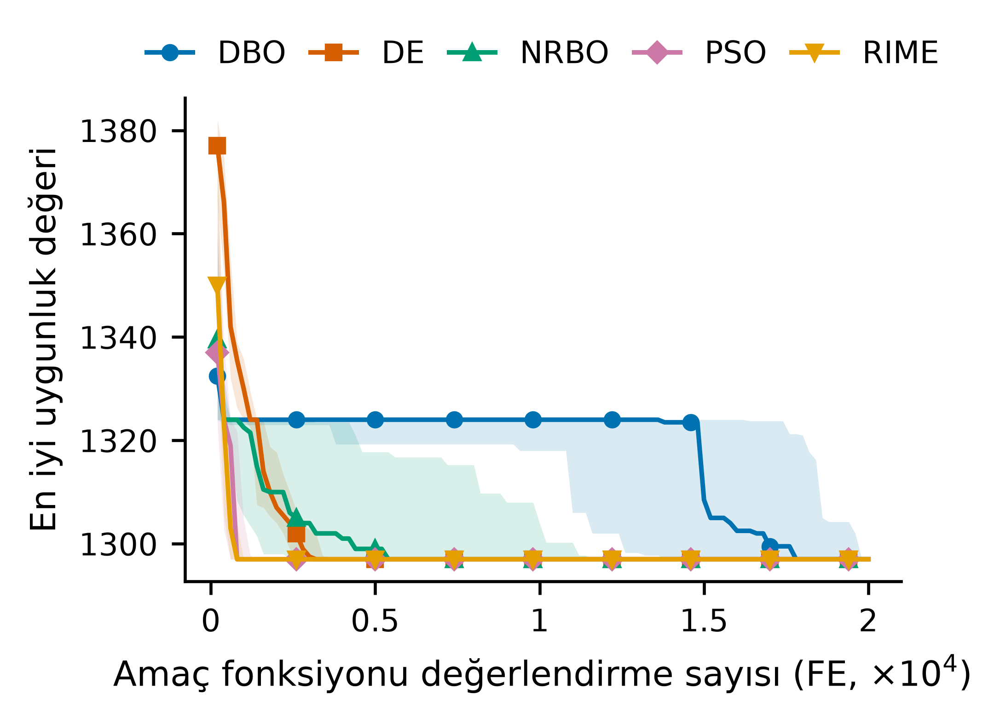

Şekil 2, ta011 için medyan yakınsama ve çeyrekler aralığı.

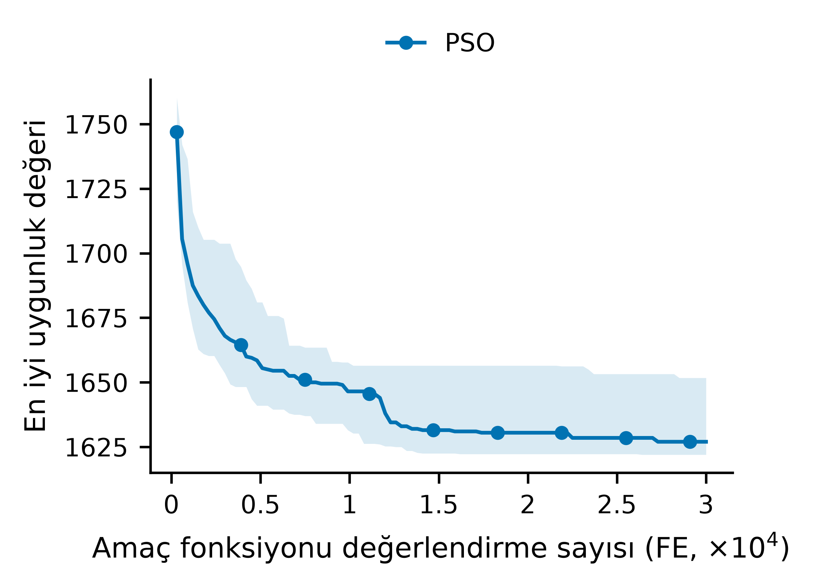

Şekil 3, ta021 için medyan yakınsama ve çeyrekler aralığı.

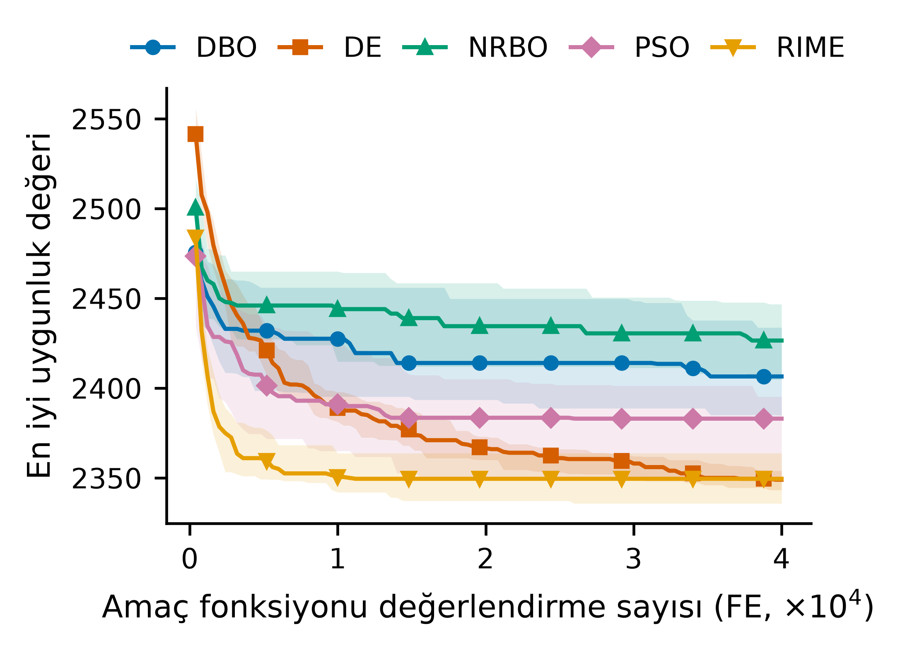

Ta001'de DBO orta bütçede 1324 medyanındayken diğerlerinin çoğu 1297 düzeyindedir; finalde hepsi 1297 medyanına ulaşır. Ta011'de RIME erken kesitte düşük medyan elde eder, DE bütçe boyunca iyileşir. Ta021'de RIME erken doygunluğa yakın görünürken DE ilerleyen değerlendirmelerde iyileşir. Bu eğriler bütün koşuların aynı yolu izlediği veya belirli operatörün nedensel üstünlüğü anlamına gelmez.

### 3.5. Kararlılık Analizi

Şekil 4–6 final Cmax dağılımlarını verir; her nokta bir koşudur. Ta001'de RIME'ın dar dağılımı ile DE'nin tek iyi koşusu farklı başarı boyutlarıdır. Ta011'de DE daha dar, RIME daha düşük merkezli dağılım sunar. Ta021'de DE'nin düşük yayılımı, RIME'ın yakın medyanıyla birlikte değerlendirilir. Standart sapma tek başına kalite değildir; kötü ama dar dağılım üstünlük sayılmaz.

Şekil 4, ta001 için 30 final Cmax değerinin kutu grafiği.

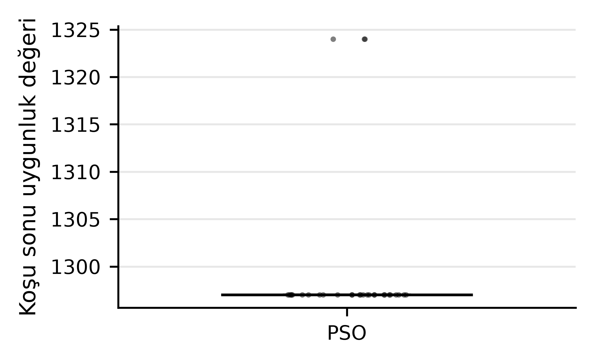

Şekil 5, ta011 için 30 final Cmax değerinin kutu grafiği.

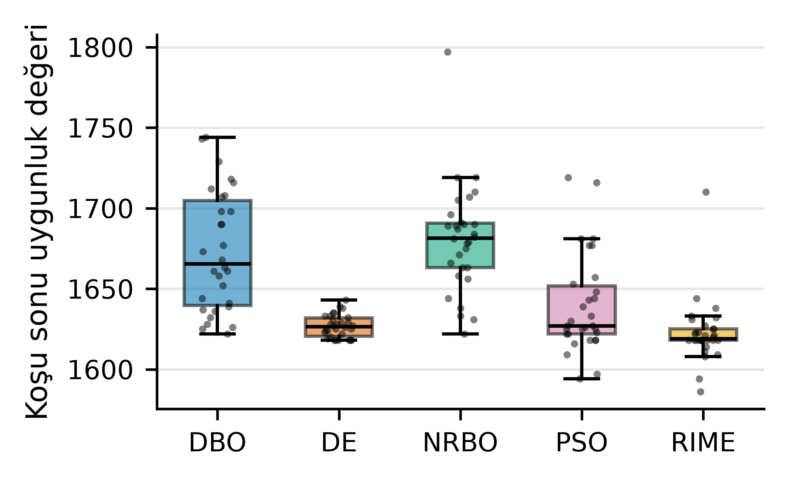

Şekil 6, ta021 için 30 final Cmax değerinin kutu grafiği.

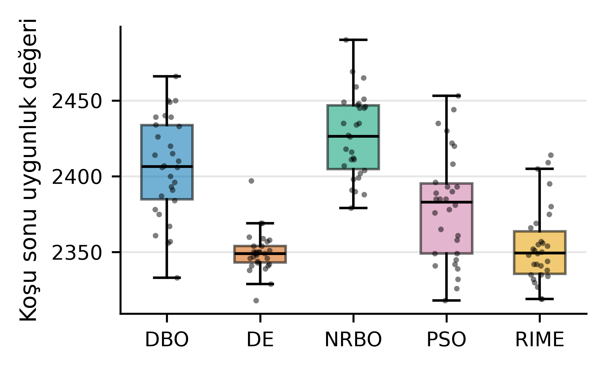

### 3.6. İstatistiksel Karşılaştırma

Tablo 8–10 mevcut rank-sum çıktılarının bütün satırlarını aynen taşır. `+` referansın daha düşük medyanla anlamlı farkını, `=` anlamlı fark bulunmadığını belirtir; eşdeğerlik kanıtı değildir.

**Tablo 8. ta001: Wilcoxon sıra toplamı ve Holm.**

<!-- data:wilcoxon_ta001 -->
| Karşılaştırma | z | p-değeri | p (Holm) | Sonuç |
| --- | --- | --- | --- | --- |
| DBO – DE | 1.722 | 0.085 | 0.34 | = |
| DBO – NRBO | 0.6357 | 0.525 | 0.8238 | = |
| DBO – PSO | 0.8205 | 0.4119 | 0.8238 | = |
| DBO – RIME | 1.382 | 0.1669 | 0.5006 | = |
<!-- /data:wilcoxon_ta001 -->

**Tablo 9. ta011: Wilcoxon sıra toplamı ve Holm.**

<!-- data:wilcoxon_ta011 -->
| Karşılaştırma | z | p-değeri | p (Holm) | Sonuç |
| --- | --- | --- | --- | --- |
| RIME – DBO | -5.729 | 1.01e-08 | 3.031e-08 | + |
| RIME – DE | -2.58 | 0.009883 | 0.01219 | + |
| RIME – NRBO | -5.973 | 2.331e-09 | 9.322e-09 | + |
| RIME – PSO | -2.743 | 0.006097 | 0.01219 | + |
<!-- /data:wilcoxon_ta011 -->

**Tablo 10. ta021: Wilcoxon sıra toplamı ve Holm.**

<!-- data:wilcoxon_ta021 -->
| Karşılaştırma | z | p-değeri | p (Holm) | Sonuç |
| --- | --- | --- | --- | --- |
| DE – DBO | -5.847 | 4.998e-09 | 1.499e-08 | + |
| DE – NRBO | -6.594 | 4.286e-11 | 1.714e-10 | + |
| DE – PSO | -3.164 | 0.001557 | 0.003114 | + |
| DE – RIME | -0.02957 | 0.9764 | 0.9764 | = |
<!-- /data:wilcoxon_ta021 -->

Ta001'de medyanlar eşit olduğundan DBO alfabetik ilk referanstır. Bu dört çiftte anlamlı fark yoktur; DE–RIME rank-sum sonucu tablodan çıkarılamaz. Ta011'de RIME dört karşılaştırmada anlamlı bulunur. Ta021'de DE, DBO/NRBO/PSO'ya karşı anlamlıdır; DE–RIME farkı anlamlı değildir.

**Tablo 11. Örnek başına Friedman ve Nemenyi eşiği.**

<!-- data:friedman -->
| Örnek | Friedman istatistiği | p | Blok | Yöntem | CD |
| --- | --- | --- | --- | --- | --- |
| ta001 | 11.656442 | 0.0200975631331 | 30 | 5 | 1.113701 |
| ta011 | 55.899160 | 2.10520296168e-11 | 30 | 5 | 1.113701 |
| ta021 | 70.533333 | 1.75141438413e-14 | 30 | 5 | 1.113701 |
<!-- /data:friedman -->

**Tablo 12. ta001: kaydedilmiş Friedman sıraları.**

<!-- data:ranks_ta001 -->
| Algoritma | Ortalama Friedman sırası | Genel sıra |
| --- | --- | --- |
| DE | 2.7 | 1.0 |
| RIME | 2.85 | 2.0 |
| PSO | 3.0 | 3.0 |
| NRBO | 3.067 | 4.0 |
| DBO | 3.383 | 5.0 |
<!-- /data:ranks_ta001 -->

**Tablo 13. ta011: kaydedilmiş Friedman sıraları.**

<!-- data:ranks_ta011 -->
| Algoritma | Ortalama Friedman sırası | Genel sıra |
| --- | --- | --- |
| RIME | 1.733 | 1.0 |
| DE | 2.367 | 2.0 |
| PSO | 2.667 | 3.0 |
| DBO | 4.05 | 4.0 |
| NRBO | 4.183 | 5.0 |
<!-- /data:ranks_ta011 -->

**Tablo 14. ta021: kaydedilmiş Friedman sıraları.**

<!-- data:ranks_ta021 -->
| Algoritma | Ortalama Friedman sırası | Genel sıra |
| --- | --- | --- |
| RIME | 1.8 | 1.0 |
| DE | 1.867 | 2.0 |
| PSO | 2.933 | 3.0 |
| DBO | 3.833 | 4.0 |
| NRBO | 4.567 | 5.0 |
<!-- /data:ranks_ta021 -->

**Tablo 15. Tam hassasiyetli sıralardan CD eşiğini aşan çiftler.**

<!-- data:nemenyi -->
| Örnek | CD'yi aşan sıra farkı çiftleri |
| --- | --- |
| ta001 | Yok |
| ta011 | DBO / DE; DBO / PSO; DBO / RIME; DE / NRBO; NRBO / PSO; NRBO / RIME |
| ta021 | DBO / DE; DBO / RIME; DE / NRBO; NRBO / PSO; NRBO / RIME; PSO / RIME |
<!-- /data:nemenyi -->

Üç Friedman testi de anlamlı olduğundan CD diyagramları üretilmiştir. Ta001'de omnibus test anlamlı olsa da hiçbir çift Nemenyi eşiğini aşmaz; bu çelişki değildir. Ta011'de RIME–DE Nemenyi eşiğini aşmazken rank-sum/Holm tablosunda anlamlıdır; gözlem kullanımı ve çoklu karşılaştırma aileleri farklıdır. Ta021'de DE–RIME iki yaklaşımda da ayrılmaz. Bulgular tek mutlak sıralamaya indirgenmemiştir.

Şekil 7, ta001 için ortalama sıralar ve Nemenyi kritik farkı.

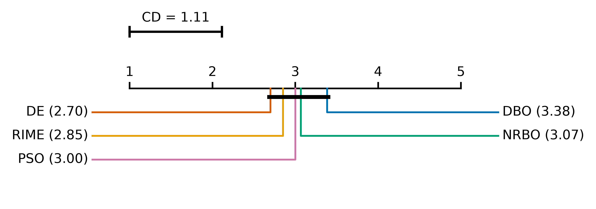

Şekil 8, ta011 için ortalama sıralar ve Nemenyi kritik farkı.

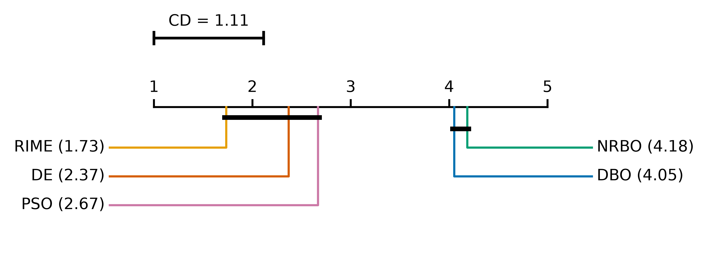

Şekil 9, ta021 için ortalama sıralar ve Nemenyi kritik farkı.

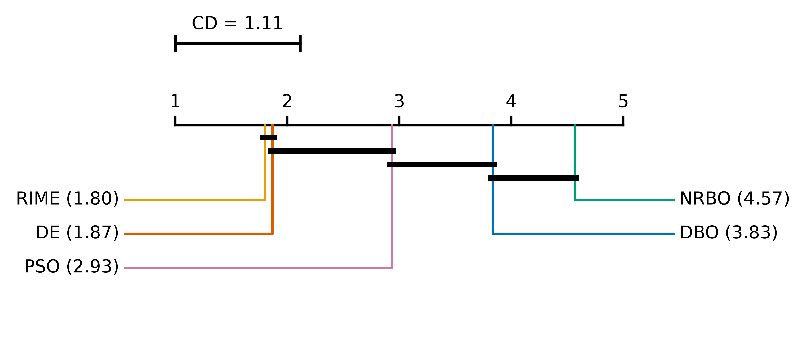

### 3.7. En İyi Çözüm ve Gantt Gösterimi

Her örnekte bütün algoritma/run kayıtları arasındaki minimum Cmax seçilir. Eşitlikte en küçük run, sonra alfabetik algoritma adı kullanılır. Ta001 ve ta011 minimumları tekildir; ta021 minimumu DE/run 14 ve PSO/run 17 tarafından paylaşılır. Tablo 16 bütün eşit minimumları içerir. Ta021 Gantt'ında DE/run 14 kullanılmıştır.

**Tablo 16. Final en iyi koşular ve bütün minimum eşitlikleri.**

<!-- data:best -->
| Örnek | Yöntem | Run | Seed | Cmax | RPD (%) | Permütasyon (1 tabanlı) |
| --- | --- | --- | --- | --- | --- | --- |
| ta001 | DE | 30 | 2055 | 1288 | 0.782473 | 17 9 15 8 3 14 16 6 11 19 13 5 4 18 1 2 7 10 20 12 |
| ta011 | RIME | 25 | 2050 | 1586 | 0.252845 | 18 5 2 12 9 10 15 17 14 3 4 6 19 8 20 11 13 7 1 16 |
| ta021 | DE | 14 | 2039 | 2318 | 0.914236 | 16 18 8 13 9 14 15 10 1 20 17 11 5 6 12 7 2 4 3 19 |
| ta021 | PSO | 17 | 2042 | 2318 | 0.914236 | 16 8 7 12 18 15 13 9 6 10 11 5 20 14 2 4 17 1 3 19 |
<!-- /data:best -->

[Bağımsız doğrulama özeti](support/final_best_schedules.md), [ta001 zamanları](support/schedule_ta001.csv), [ta011 zamanları](support/schedule_ta011.csv), [ta021 zamanları](support/schedule_ta021.csv) verifier çıktılarıdır. Şekil 10–12 bunlardan çizilmiştir; işlem zamanları elle üretilmemiştir. Zaman birimi benchmark birimidir, saniye varsayılmaz.

Şekil 10, ta001 seçili en iyi çözümünün çakışmasız çizelgesidir.

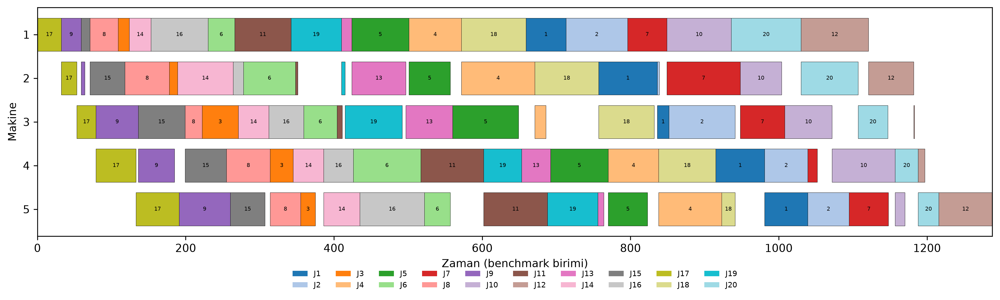

Şekil 11, ta011 seçili en iyi çözümünün çakışmasız çizelgesidir.

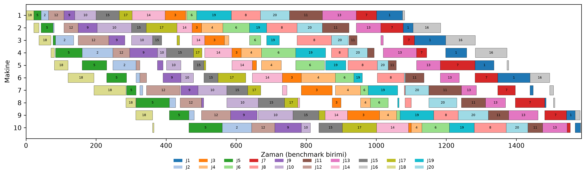

Şekil 12, ta021 seçili en iyi çözümünün çakışmasız çizelgesidir.

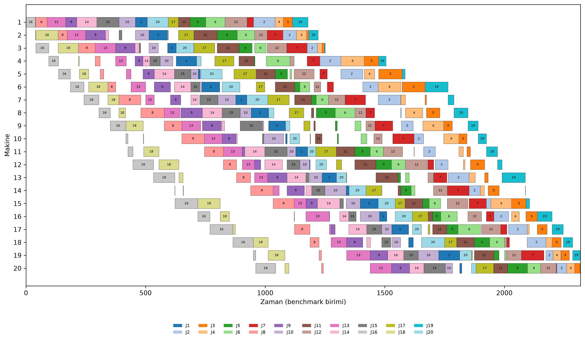

### 3.8. Hesaplama Maliyeti

Tablo 17'de ortalama süreler istatistik CSV'sinden, süre standart sapmaları ham `time` sütunundan alınmıştır. Ölçü birimi saniyedir. DBO bu kayıtlı ortamda üç örnekte de en düşük, NRBO en yüksek ortalama süreyi vermiştir. Düşük runtime tek başına iyi Cmax değildir.

**Tablo 17. Final koşuların ölçülmüş süreleri.**

<!-- data:runtime -->
| Örnek | Yöntem | Ort. süre (s) | Süre std. (s) |
| --- | --- | --- | --- |
| ta001 | DBO | 1.508162 | 0.037801 |
| ta001 | DE | 2.076895 | 0.031825 |
| ta001 | NRBO | 2.863740 | 0.074990 |
| ta001 | PSO | 1.609686 | 0.038811 |
| ta001 | RIME | 1.935841 | 0.059800 |
| ta011 | DBO | 3.489948 | 0.163062 |
| ta011 | DE | 4.307472 | 0.087779 |
| ta011 | NRBO | 5.353418 | 0.087068 |
| ta011 | PSO | 3.538647 | 0.039635 |
| ta011 | RIME | 3.989742 | 0.043880 |
| ta021 | DBO | 7.685562 | 0.098961 |
| ta021 | DE | 8.783263 | 0.121038 |
| ta021 | NRBO | 10.173185 | 0.053443 |
| ta021 | PSO | 7.879378 | 0.164444 |
| ta021 | RIME | 8.528509 | 0.118686 |
<!-- /data:runtime -->

NEH süreleri ayrı Ubuntu/Python 3.12 CI ortamında ölçülmüştür; Windows final deneyleriyle hız oranı hesaplanmamıştır. CPU/RAM ve arka plan yükü teyidi gelmeden süreler bu kayıtların betimsel özetidir. Eşit FE, operatör ve sınır yönetimi maliyetlerini eşitlemez.

### 3.9. Tartışma ve sınırlılıklar

Rank-sum/Holm ile Friedman/Nemenyi farklı aile ve bloklama düzenleri kullanır. Aynı seed ortak rastgele etki garantisi vermez; ayrık Cmax bağları rank-sum yorumunu sınırlar. Bulgular genel üstünlük veya eşdeğerlik kanıtı değildir. NEH kalitesi karşılaştırılabilir, ancak farklı ortamın tek runtime ölçümüyle hız iddiası kurulamaz.

Kapsam üç Taillard örneği, yirmi iş ve sabit parametrelerle sınırlıdır. Farklı iş sayısı, makine grubu, eşit ayarlama bütçesi ve temsil için ek deney gerekir. Tekrar permütasyon oranı ölçülmemiştir; sınırda birikme veya operatör etkisine nedensel açıklama getirilemez. Hibrit arama, taklit öğrenmesi ve MIP komşuluk araması farklı maliyet düzenlerine sahiptir; onların performansını aşma iddiası yoktur. ([Tsiftsoglou et al., 2026](#ref-L10)); ([Li et al., 2024](#ref-L11)); ([Cáceres-Gelvez et al., 2026](#ref-L12))

Gelecek çalışma için geniş benchmark ailesi, bağ/eşleştirme duyarlılığı incelemesi, permütasyon tekrar kaydı ve FE bütçesine dahil yerel arama ablation deneyleri önerilir. Bunlar mevcut 450 koşunun parçası değildir. Taslak, insan bağımsız incelemesi, donanım ve yazar beyanları tamamlanmadan gönderime hazır sayılmaz.

## 4. Conclusion

Ortak temsil ve eşit FE altında 450 koşu, tek yöntemin bütün kalite ve kararlılık ölçülerinde üstün olmadığını göstermiştir. Ta001'de DE'nin iyi tek koşusu ile RIME'ın dar dağılımı ayrışırken NEH gözlenen bütün minimumlardan iyi sonuç vermiştir. Ta011'de RIME düşük merkezli dağılım ve en iyi koşu, DE dar yayılım sunmuştur. Ta021'de DE ve PSO en iyi Cmax değerini paylaşmış, dağılım ve sıra ölçüleri DE ile RIME'ı öne çıkarmıştır. Minimum, medyan, yayılım ve süre birlikte değerlendirilmelidir.

Çıkarımlar üç örnek ve sabit konfigürasyonla sınırlıdır; geniş PFSP ailesine genel üstünlük iddiası taşınmaz. İnsan incelemesi ve yazar beyanları gönderim öncesinde tamamlanmalıdır.

## Declarations

**Yazar Katkı Beyanı — CRediT taslağı:** Muhammed: Project administration, Software (RIME), Writing – review & editing; Burak: Software (DBO/NRBO), Methodology; Şeref: Methodology (PFSP, DE, NEH), Validation, Data curation (benchmark); Tarık: Software (PSO/deney altyapısı), Investigation (deney), Formal analysis, Validation; Bilal: Writing – original draft (giriş/literatür), Writing – review & editing (birleştirme), Visualization (doğrulanmış Gantt ve şekil yerleştirme). Abdullah ELEN: Supervision rolü danışman teyidine tabidir. Görev dağılımına dayanan bu taslakta fiilî katkı, sıra ve puanlar bütün yazarlar/danışman tarafından onaylanacaktır. Eşit katkı yüzdesi uydurulmamıştır.

**Veri ve Kod Erişilebilirliği:** [mamyylmz/-Akis_Tipi_Cizelgeleme](https://github.com/mamyylmz/-Akis_Tipi_Cizelgeleme); deney sürümü `73ce39c78a6263ce6f252267edeff0515157aca1`. [Manifest](../results/tables/experiment_manifest.json), [doğrulama kaydı](../results/verification.json), [ham sonuçlar](../results/raw/) ve [metadata](../data/taillard/reference_solutions.json) izlenebilirlik zinciridir. Kalıcı arşiv DOI'si ve lisans/erişim onayı [TEYİT BEKLİYOR]; depo adresi bunların varlığı iddiası değildir.

**Yapay Zekâ Kullanım Beyanı:** ChatGPT/Codex (OpenAI), kaynak tarama desteği, metin düzenleme ve birleştirme, mevcut sonuçların betikle aktarılması, doğrulama komutlarının yürütülmesi ve bağımsız verifier çıktısından Gantt çizim kodunun hazırlanmasında kullanılmıştır. Deney sayıları, kaynak kimlikleri ve yazar bilgileri üretken metinle uydurulmamıştır. Bilimsel yorumların, kaynak erişim sınırlarının, kodun ve tüm beyanların nihai doğrulama ve sorumluluğu insan yazarlardadır. Diğer ekip araçları, kullanım kapsamları ve sürümleri [TEYİT BEKLİYOR]; bu kayıt insan bağımsız incelemesi yerine geçmez.

**Etik Kurul Onayı:** Çalışma kamuya açık sayısal benchmarklarla hesaplamalı optimizasyondur; insan/hayvan deneyi veya kişisel katılımcı verisi içermez. Etik kurul izni gerektirmediği ifadesi kurum/dergi gereklilikleri bakımından danışman teyidine tabidir. Olmayan onay numarası yazılmamıştır.

**Çıkar Çatışması:** Çıkar çatışması yoktur (yazar teyidi bekleniyor). Bu standart taslak, tüm yazarlarca teyit edilmiş ortak beyan değildir: [TEYİT BEKLİYOR].

**Teşekkür ve Finansman:** Dış finansman alınmamıştır (yazar teyidi bekleniyor). Bu standart taslak henüz doğrulanmış finansman beyanı değildir: [TEYİT BEKLİYOR]. Varsa teşekkür edilecek katkılar ve kurum desteği ayrıca yazarlarca bildirilecektir.

## References

Kaynaklar soyada göre sıralanmıştır. Kimlik ve DOI bilgileri mevcut literatür ve yöntem kayıtlarına dayanır; bütün tam metinlerin bu turda yeniden açıldığı iddia edilmez. NEH, DBO ve NRBO erişim sınırları korunmuştur. Shi ve Eberhart kaydı [PSO yöntem metninden](method_pso.md) alınmıştır.

<a id="ref-L03"></a>

Bean, J. C. (1994). Genetic algorithms and random keys for sequencing and optimization. *ORSA Journal on Computing, 6*(2), 154–160. [DOI](https://doi.org/10.1287/ijoc.6.2.154)

<a id="ref-L12"></a>

Cáceres-Gelvez, S., Dang, T. H., & Letchford, A. N. (2026). MIP-based local search for permutation flowshop scheduling with makespan objective. *Computers & Operations Research, 186*, 107309. [DOI](https://doi.org/10.1016/j.cor.2025.107309)

<a id="ref-L09"></a>

Gmys, J. (2022). Exactly solving hard permutation flowshop scheduling problems on peta-scale GPU-accelerated supercomputers. *INFORMS Journal on Computing, 34*(5), 2502–2522. [DOI](https://doi.org/10.1287/ijoc.2022.1193)

<a id="ref-L05"></a>

Kennedy, J., & Eberhart, R. (1995). Particle swarm optimization. *Proceedings of ICNN’95 – International Conference on Neural Networks*, 4, 1942–1948. IEEE. [DOI](https://doi.org/10.1109/ICNN.1995.488968)

<a id="ref-L11"></a>

Li, L., Liang, S., Zhu, Z., Ding, C., Zha, H., & Wu, B. (2024). Learning to optimize permutation flow shop scheduling via graph-based imitation learning. *Proceedings of the AAAI Conference on Artificial Intelligence, 38*(18), 20185–20193. [DOI](https://doi.org/10.1609/AAAI.v38i18.29998)

<a id="ref-L02"></a>

Nawaz, M., Enscore, E. E., Jr., & Ham, I. (1983). A heuristic algorithm for the m-machine, n-job flow-shop sequencing problem. *Omega, 11*(1), 91–95. [DOI](https://doi.org/10.1016/0305-0483(83)90088-9)

<a id="ref-P98"></a>

Shi, Y., & Eberhart, R. (1998). A modified particle swarm optimizer. *Proceedings of the 1998 IEEE International Conference on Evolutionary Computation*, 69–73. [DOI](https://doi.org/10.1109/ICEC.1998.699146).

<a id="ref-L08"></a>

Sowmya, R., Premkumar, M., & Jangir, P. (2024). Newton-Raphson-based optimizer: A new population-based metaheuristic algorithm for continuous optimization problems. *Engineering Applications of Artificial Intelligence, 128*, 107532. [DOI](https://doi.org/10.1016/j.engappai.2023.107532)

<a id="ref-L04"></a>

Storn, R., & Price, K. (1997). Differential evolution – A simple and efficient heuristic for global optimization over continuous spaces. *Journal of Global Optimization, 11*(4), 341–359. [DOI](https://doi.org/10.1023/A:1008202821328)

<a id="ref-L07"></a>

Su, H., Zhao, D., Heidari, A. A., Liu, L., Zhang, X., Mafarja, M., & Chen, H. (2023). RIME: A physics-based optimization. *Neurocomputing, 532*, 183–214. [DOI](https://doi.org/10.1016/j.neucom.2023.02.010)

<a id="ref-L01"></a>

Taillard, E. (1993). Benchmarks for basic scheduling problems. *European Journal of Operational Research, 64*(2), 278–285. [DOI](https://doi.org/10.1016/0377-2217(93)90182-M)

<a id="ref-L10"></a>

Tsiftsoglou, M., Marinakis, Y., & Marinaki, M. (2026). Optimizing the permutation flowshop scheduling problem with an improved sparrow search algorithm. *Algorithms, 19*(4), 283. [DOI](https://doi.org/10.3390/a19040283)

<a id="ref-L06"></a>

Xue, J., & Shen, B. (2023). Dung beetle optimizer: A new meta-heuristic algorithm for global optimization. *The Journal of Supercomputing, 79*, 7305–7336. [DOI](https://doi.org/10.1007/s11227-022-04959-6)

## Appendices

**Ek A — Parametreler ve işlem sırası.** Tablo 2 manifestin tam etkin parametre listesidir. Ortak akış: seed ile RNG → uniform başlat ve her objective çağrısını say → aday üret → sınır yönetimi → bütçe varsa değerlendir → kabul/en iyi/history güncelle → exact FE'de dur. DE değişmez nesil ebeveynlerini, PSO hız/pbest/gbest'i, DBO dört rolü, RIME soft/hard-rime ve positive greedy seçimini, NRBO NRSR ardından olasılıklı TAO'yu kullanır. Ayrıntılar yöntem alt bölümlerindedir.

**Ek B — Örnekler ve ek sonuçlar.** Ek benchmark deneyi yürütülmemiştir. Tablo 5 ve 8–17 bütün zorunlu örnekleri kapsar. Ham kayıtlar [ta001](../results/raw/ta001/), [ta011](../results/raw/ta011/), [ta021](../results/raw/ta021/) dizinlerinde; NEH [ayrı kayıtta](support/neh_baseline.md), küçük model örneği [doğrulama tablosundadır](support/small_example_schedule.md).

**Ek C — Permütasyon, seed ve yeniden üretim.** Tablo 16 en iyi permütasyonları 1 tabanlı verir; [çizelge özeti](support/final_best_schedules.md) verifier komutlarını içerir. Seed listesi:

```text
2026 2027 2028 2029 2030 2031 2032 2033 2034 2035
2036 2037 2038 2039 2040 2041 2042 2043 2044 2045
2046 2047 2048 2049 2050 2051 2052 2053 2054 2055
```

Her objective çağrısı bir FE'dir. Deney commit'i `73ce39c78a6263ce6f252267edeff0515157aca1`, belge/validator kontrol tabanı `3589e6b` olup birbirine karıştırılmaz. Ayrı temiz deney checkout'unda yeniden üretim:

```powershell
python src/main.py --runs 30
python src/main.py --only-analysis
```

Mevcut sonuçları değiştirmeden belge ve veri kontrolü:

```powershell
$env:PYTHONDONTWRITEBYTECODE='1'
python docs/check_literature.py
python tools/check_repo_integrity.py
python tools/check_experiment_outputs.py --raw-dir results/raw --runs 30 --seed-base 2026
python -m unittest discover -s tests -v
python -B tools/prepare_paper_assets.py --check
```

Gantt/çizelge desteğini yalnız `paper/support/` altında yeniden üretmek için `python -B tools/prepare_paper_assets.py --generate` kullanılır. NASE kopyası `python -B tools/prepare_paper_assets.py --nase` ile ders metninden türetilir. Sayılar kaynak CSV/manifest üzerinden kontrol edilir; sonuçlar elle düzeltilmez.
