# Equal-Evaluation-Budget Comparison of Five Metaheuristics for Permutation Flow Shop Makespan Minimization

**NASE ENGLISH MANUSCRIPT — EDITORIAL REVIEW DRAFT, 25 November 2026.** This is the English-language journal adaptation of [the canonical course manuscript](outline.md), not a separate experiment. Numerical tables are reproduced directly from the frozen final results and verified against the course version. Author identifiers, declarations, Word-template formatting and advisor approval remain outstanding. **Not approved for submission.**

## Title and author information

**Title:** Comparing Five Metaheuristic Algorithms for Permutation Flow Shop Makespan under Equal Evaluation Budgets

**Authors (provisional order):** Abdullah ELEN; Muhammed YILMAZ; Burak Münteha ELLİK; Şeref TEKMAN; Tarık KARAOĞLAN; Bilal Erkan TAŞKIN.

**Common affiliation (as confirmed by Bilal):** Department of Software Engineering, Faculty of Engineering and Natural Sciences, Bandırma Onyedi Eylül University, Balıkesir, Türkiye. **Email, ORCID and corresponding-author details: [AUTHOR VERIFICATION REQUIRED].** The advisor is listed first and the project leader second according to the course rule; the remaining order requires a contribution-based decision and advisor approval.

## Abstract

Permutation flow shop scheduling requires a common job order on all machines, and the chosen permutation determines the makespan. This study compares Differential Evolution (DE), Particle Swarm Optimization (PSO), Dung Beetle Optimizer (DBO), RIME and the Newton–Raphson-Based Optimizer (NRBO) under a shared random-key representation and equal objective-function evaluation budgets. The Taillard instances ta001 (20 jobs, 5 machines), ta011 (20 jobs, 10 machines) and ta021 (20 jobs, 20 machines) are evaluated with 20,000, 30,000 and 40,000 function evaluations per run, respectively. Thirty independent runs per algorithm and instance yield 450 runs and 13.5 million evaluations in total. The deterministic Nawaz–Enscore–Ham (NEH) heuristic provides a separate classical baseline. The best observed makespans are 1288, 1586 and 2318. DE attains the minimum in ta001, RIME in ta011, while DE and PSO tie in ta021. For ta001, all methods have a median makespan of 1297, whereas NEH obtains 1286. The Holm-adjusted rank-sum analysis favors RIME against the four alternatives for ta011; it does not detect a difference between DE and RIME in ta021. Independent schedule reconstruction confirms the selected makespans and the absence of resource or precedence conflicts. Conclusions concern these three instances and fixed parameter settings rather than universal algorithm superiority.

**Keywords:** Random-key encoding; Taillard benchmarks; Stable sorting; Holm correction; Run-to-run variability; Reproducibility.

## 1. Introduction

In a permutation flow shop scheduling problem (PFSP), each job visits all machines in the same order, and a single job permutation is maintained across machines. Every machine processes at most one job at any time; operations are non-preemptive, and a job cannot start its next operation before completing the preceding one. Our objective is to minimize the completion time of the last job on the last machine, i.e., the makespan Cmax, not the sum of job completion times. The deterministic schedule is easy to compute for a fixed permutation, but the factorial permutation space makes exhaustive search impractical at realistic sizes ([Taillard, 1993](#ref-L01); [Gmys, 2022](#ref-L09)).

The classical NEH insertion heuristic remains a useful reference because it constructs a feasible sequence without stochastic repetition ([Nawaz et al., 1983](#ref-L02)). In contrast, recent PFSP work ranges from hybrid stochastic search to graph-based imitation learning and mixed-integer-programming neighborhoods. These methods differ in their search operators, training or solver requirements, and computational budgets; their published scores therefore cannot automatically be compared under a common function-evaluation allowance ([Tsiftsoglou et al., 2026](#ref-L10); [Li et al., 2024](#ref-L11); [Cáceres-Gelvez et al., 2026](#ref-L12)).

We examine five continuous metaheuristics with the same random-key decoding and per-instance evaluation budget. DE uses vector differences and binomial crossover ([Storn & Price, 1997](#ref-L04)); PSO combines personal and swarm best positions ([Kennedy & Eberhart, 1995](#ref-L05); [Shi & Eberhart, 1998](#ref-P98)); DBO uses specialized beetle roles ([Xue & Shen, 2023](#ref-L06)); RIME combines soft- and hard-rime searches ([Su et al., 2023](#ref-L07)); and NRBO uses Newton–Raphson-inspired search and trap avoidance ([Sowmya et al., 2024](#ref-L08)). Real-valued keys represent permutations without introducing infeasible duplicated or missing jobs ([Bean, 1994](#ref-L03)).

The research question is how the five methods differ in makespan quality, run-to-run variability and measured runtime when given identical objective-evaluation budgets. Our contribution is a reproducible, source-linked comparison with 30 runs per method and benchmark, independent schedule verification, explicit FE accounting, statistical analysis and a separate NEH baseline. Section 2 specifies the model and methods, Section 3 presents results and their limitations, and Section 4 concludes.

## 2. Materials and Methods

### 2.1. Problem, benchmarks and evaluation

For n jobs and m machines, let p[j,k] denote the processing duration of job j on machine k, and let π denote a permutation of all jobs. Starting with a zero-filled completion-time boundary, we use the recurrence C[i,k] = max(C[i−1,k], C[i,k−1]) + p[π[i],k]. The objective is Cmax(π) = C[n,m]. The model imposes the standard no-overlap and job-precedence constraints. Its evaluation is deterministic for a given permutation.

All five optimizers operate on x ∈ [0,1]^n. Sorting the key vector in ascending stable order gives the job permutation; clipping precedes objective evaluation. Stable sorting deterministically breaks ties in favor of original job index. This encoding always produces a complete feasible permutation but may map many different continuous vectors to the same schedule ([Bean, 1994](#ref-L03)).

Three Taillard benchmarks and their source checksums are fixed. The values 1278, 1582 and 2297 are published/reference makespans reproducible from recorded permutations; we do not assert proven global optimality for every reference. The small 5-job/3-machine teaching example (J4,J2,J1,J5,J3) produces Cmax=20 and is a validation case rather than an optimum claim.

**Table 1. Benchmarks and evaluation budgets.**

<!-- data:benchmarks -->
| Instance | Dimensions | Benchmark seed | Reference | FE/run | SHA-256 |
| --- | --- | --- | --- | --- | --- |
| ta001 | 20×5 | 873654221 | 1278 | 20000 | `68164a1350ad2252e224b3fc36872ec65556f04cb6cd6914abaa455910867bf2` |
| ta011 | 20×10 | 587595453 | 1582 | 30000 | `e291f3f94885af40c9b9509cd9e939d66d4455d3611db55b42b3bfb801cf6656` |
| ta021 | 20×20 | 479340445 | 2297 | 40000 | `2fbd5446f94ebb5bfcf81fc0fcc4f5624294bfc4532c7f46354e76e832810f59` |
<!-- /data:benchmarks -->

The experiments use 20,000, 30,000 and 40,000 objective-function evaluations (FE) per run for ta001, ta011 and ta021, respectively. Initial population evaluations consume budget. Each method is run 30 times per instance using the shared seed list 2026–2055, for 450 independent invocations and 13,500,000 FE in total. Equal FE does not imply equal population size or execution time. NEH is evaluated once per benchmark, outside the stochastic 450-run design.

### 2.2. Optimization methods and fixed settings

**Differential Evolution (DE).** The implemented DE/rand/1/bin uses 100 individuals for n=20, a mutation factor F=0.5 and crossover rate CR=0.9. A trial vector is generated by v = x[r1] + F(x[r2]−x[r3]), followed by coordinate-wise binomial crossover with a forced mutant coordinate. The clipped trial replaces the current target on non-worsening fitness. Parent vectors are read from an immutable generation snapshot; a partially completed generation ends when the exact FE allowance is exhausted ([Storn & Price, 1997](#ref-L04)).

**Particle Swarm Optimization (PSO).** Thirty particles use a personal best and a global swarm best. Velocity is updated as v_i ← w v_i + c1 r1(pbest_i−x_i) + c2 r2(gbest−x_i), followed by velocity clipping and position clipping. The inertia coefficient decreases from 0.9 to 0.4 according to the FE fraction consumed at the beginning of each outer sweep, while c1=c2=2.0 and the velocity limit is 0.2 times the search range. FE-based inertia scheduling is a project adaptation; inertia weighting is associated with [Shi and Eberhart (1998)](#ref-P98).

**Dung Beetle Optimizer (DBO).** Thirty individuals form four functional groups: six rolling beetles, six brood beetles, seven small beetles and eleven thieves. Rolling, dancing, brood search, foraging and theft use the source-inspired equations; the development preserves documented deviations regarding dancing at 90°/180° and converts the original iteration-dependent R coefficient into an FE fraction. These are explicit project adaptations rather than verbatim proof of inaccessible original typeset equations ([Xue & Shen, 2023](#ref-L06)). The parameters are k=0.1, b=0.3, S=0.5, roll probability 0.9 and negative-direction probability 0.1.

**RIME.** Thirty agents combine soft-rime exploration around the current global best, hard-rime coordinate replacement controlled by normalized fitness and positive greedy selection. Out-of-bounds candidates are clipped before evaluation. The MATLAB author-code progression is adapted to exact FE budgets using a sweep count of ceil((max_fes−N)/N), with a partial final sweep when needed; the original iteration schedule is not claimed to be performance-equivalent to this FE-based experiment. The final RIME settings are N=30 and w=5 ([Su et al., 2023](#ref-L07)).

**Newton–Raphson-Based Optimizer (NRBO).** Thirty individuals apply a gradient-free Newton–Raphson Search Rule (NRSR) built from population and best/worst positional differences. With probability DF=0.6, a Trap Avoidance Operator (TAO) perturbs the candidate using the population mean and global best. The iteration coefficient δ=(1−2·fes/max_fes)^5 is the declared FE adaptation. Singular denominator behavior follows the documented author-code boundary policy, and no analytical PFSP gradient is used. The original published equation numbers were not directly verified ([Sowmya et al., 2024](#ref-L08)).

**Table 2. Effective optimizer settings from the final experiment manifest.**

<!-- data:parameters -->
| Algorithm | Population | Effective parameters |
| --- | --- | --- |
| DBO | 30 | S=0.5; b=0.3; deviation_prob=0.1; k=0.1; roll_prob=0.9 |
| DE | 100 | CR=0.9; F=0.5 |
| NRBO | 30 | DF=0.6 |
| PSO | 30 | c1=2.0; c2=2.0; v_frac=0.2; w_max=0.9; w_min=0.4 |
| RIME | 30 | w=5 |
<!-- /data:parameters -->

All methods use NumPy default_rng(seed). The experiment source, benchmark files, implementation-specific adaptations and full pseudocode-equivalent details are available in the linked repository at the exact experimental revision. No external ready-made metaheuristic library produced the reported results.

### 2.3. Reproducibility and statistical analysis

The final experiment revision is `73ce39c78a6263ce6f252267edeff0515157aca1`. The manifest records a clean working tree at run start, benchmark names, FE limits, effective parameters, seed base, and Python/package versions. It is distinct from later documentation/validation revisions. The raw CSV files, their SHA-256 hashes, final manifest and verification report constitute the data-provenance chain.

For each benchmark we report minimum, maximum, mean, median, sample standard deviation, mean relative percentage deviation RPD = 100(Cmax−Cref)/Cref, feasibility rate, and measured runtime. The prespecified pairwise analysis applies two-sided scipy.stats.ranksums to a reference method (the observed smallest median, with a deterministic name-based tie break) against the other four methods and adjusts those four p-values using Holm's method. This reference selection is data-dependent, and the rank-sum implementation does not correct for ties; p-values must be read as exploratory, not confirmatory familywise evidence for an all-pairs claim.

Friedman analyses treat matching run numbers/seeds as blocks within each benchmark and rank all five algorithms. The presence of a common numeric seed does not by itself guarantee a common random effect across different algorithms; the block interpretation is a protocol choice. Only following a Friedman p-value below 0.05 is the Nemenyi critical-difference threshold CD = 2.728·sqrt(k(k+1)/(6N)) calculated (k=5, N=30). An omnibus finding does not guarantee any individually significant post-hoc pair. The analyses are not pooled across unrelated benchmarks.

**Table 3. Manifest-recorded software environment.**

<!-- data:environment -->
| Field | Manifest value |
| --- | --- |
| numpy | 2.2.6 |
| os | Windows-10-10.0.19045-SP0 |
| pandas | 2.2.3 |
| python | 3.11.9 |
| scipy | 1.17.1 |
| CPU | [TEYİT BEKLİYOR] |
| RAM | [TEYİT BEKLİYOR] |
<!-- /data:environment -->

CPU, RAM, background load and power mode remain **[EXPERIMENT OPERATOR VERIFICATION REQUIRED]**. Runtime comparisons describe the recorded environment only.

**Artificial-intelligence disclosure (Materials and Methods).** ChatGPT/Codex (OpenAI) assisted with source discovery, manuscript editing, structural translation, code-review suggestions and script-based presentation of recorded outputs. Data values were derived from recorded experiments, not generated as synthetic numerical results. Authors remain responsible for all analytical claims and source verification; other AI tools and exact use details require author confirmation.

## 3. Results and Discussion

### 3.1. Numerical performance and the NEH reference

**Table 4. Distribution of final makespans over 30 runs per algorithm and instance.**

<!-- data:statistics -->
| Instance | Method | n | Best | Worst | Mean | Median | Sample SD | Mean RPD (%) | Feasible (%) |
| --- | --- | --- | --- | --- | --- | --- | --- | --- | --- |
| ta001 | DBO | 30 | 1297 | 1324 | 1301.300000 | 1297.000000 | 9.311283 | 1.823161 | 100 |
| ta001 | DE | 30 | 1288 | 1297 | 1296.700000 | 1297.000000 | 1.643168 | 1.463224 | 100 |
| ta001 | NRBO | 30 | 1296 | 1324 | 1299.900000 | 1297.000000 | 7.707363 | 1.713615 | 100 |
| ta001 | PSO | 30 | 1297 | 1324 | 1299.700000 | 1297.000000 | 8.238472 | 1.697966 | 100 |
| ta001 | RIME | 30 | 1297 | 1301 | 1297.133333 | 1297.000000 | 0.730297 | 1.497131 | 100 |
| ta011 | DBO | 30 | 1622 | 1744 | 1673.200000 | 1665.500000 | 37.269198 | 5.764855 | 100 |
| ta011 | DE | 30 | 1618 | 1643 | 1626.766667 | 1626.500000 | 7.040197 | 2.829751 | 100 |
| ta011 | NRBO | 30 | 1622 | 1797 | 1680.433333 | 1681.500000 | 33.614122 | 6.222082 | 100 |
| ta011 | PSO | 30 | 1594 | 1719 | 1639.666667 | 1627.000000 | 31.023165 | 3.645175 | 100 |
| ta011 | RIME | 30 | 1586 | 1710 | 1622.633333 | 1619.000000 | 19.999109 | 2.568479 | 100 |
| ta021 | DBO | 30 | 2333 | 2466 | 2406.066667 | 2406.500000 | 33.125606 | 4.748222 | 100 |
| ta021 | DE | 30 | 2318 | 2397 | 2349.900000 | 2349.000000 | 13.578253 | 2.303004 | 100 |
| ta021 | NRBO | 30 | 2379 | 2490 | 2426.566667 | 2426.500000 | 27.474983 | 5.640691 | 100 |
| ta021 | PSO | 30 | 2318 | 2453 | 2379.600000 | 2383.000000 | 36.146827 | 3.595995 | 100 |
| ta021 | RIME | 30 | 2319 | 2414 | 2354.100000 | 2349.500000 | 25.373554 | 2.485851 | 100 |
<!-- /data:statistics -->

The best observed makespans were 1288 (DE, ta001), 1586 (RIME, ta011) and 2318 (DE and PSO, ta021). A single best run does not describe typical behavior. In ta001 all methods have median Cmax=1297; DE attains the lowest observed run but RIME exhibits the narrowest standard deviation. In ta011 RIME has the lowest mean and median, whereas DE is less dispersed. In ta021 DE has the lowest mean; DE and RIME show similar central performance despite the minimum being shared by DE and PSO.

**Table 5. Independent deterministic NEH baselines; CI runtimes are not comparable with Windows experiment runtimes.**

<!-- data:neh -->
| Instance | Reference Cmax | NEH Cmax | RPD (%) | CI reference runtime (s) |
| --- | --- | --- | --- | --- |
| ta001 | 1278 | 1286 | 0.625978 | 0.016048 |
| ta011 | 1582 | 1680 | 6.194690 | 0.016795 |
| ta021 | 2297 | 2410 | 4.919460 | 0.027353 |
<!-- /data:neh -->

NEH yields Cmax=1286, 1680 and 2410, respectively. For ta001, NEH outperforms every observed stochastic run in this experiment. These deterministic values are descriptive references, not replicated 30-run samples.

### 3.2. Convergence and run-to-run variability

All convergence curves use the actual FE axis and recorded best-so-far histories, rather than iteration count. The budget-fraction summaries below take the last history record no later than the given FE threshold; no unobserved intermediate points are interpolated.

**Table 6. Median Cmax at recorded evaluation-budget fractions.**

<!-- data:convergence -->
| Instance | Method | Median at 25% FE | Median at 50% FE | Median at 100% FE |
| --- | --- | --- | --- | --- |
| ta001 | DBO | 1324.0 | 1324.0 | 1297.0 |
| ta001 | DE | 1297.0 | 1297.0 | 1297.0 |
| ta001 | NRBO | 1299.0 | 1297.0 | 1297.0 |
| ta001 | PSO | 1297.0 | 1297.0 | 1297.0 |
| ta001 | RIME | 1297.0 | 1297.0 | 1297.0 |
| ta011 | DBO | 1701.0 | 1701.0 | 1665.5 |
| ta011 | DE | 1676.0 | 1645.5 | 1626.5 |
| ta011 | NRBO | 1701.0 | 1692.0 | 1681.5 |
| ta011 | PSO | 1651.0 | 1631.5 | 1627.0 |
| ta011 | RIME | 1621.0 | 1620.5 | 1619.0 |
| ta021 | DBO | 2427.5 | 2414.0 | 2406.5 |
| ta021 | DE | 2389.0 | 2366.5 | 2349.0 |
| ta021 | NRBO | 2444.0 | 2434.5 | 2426.5 |
| ta021 | PSO | 2391.0 | 2383.5 | 2383.0 |
| ta021 | RIME | 2350.5 | 2349.5 | 2349.5 |
<!-- /data:convergence -->

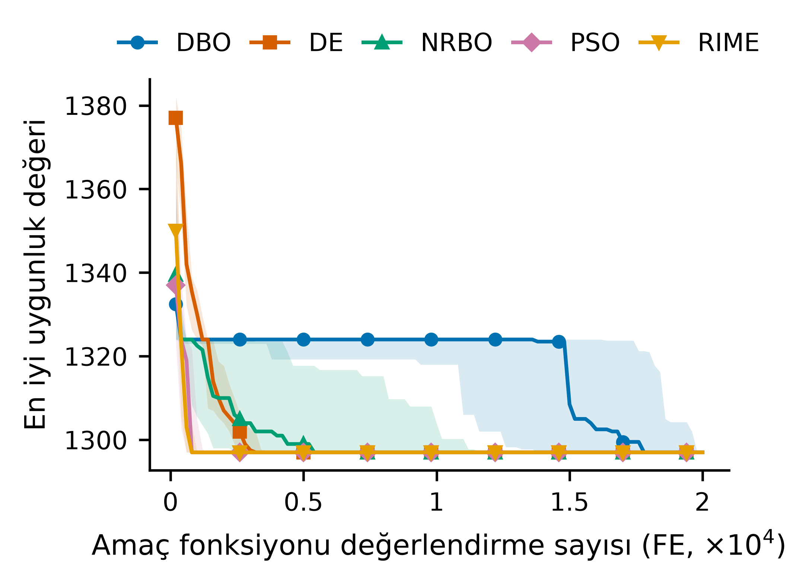

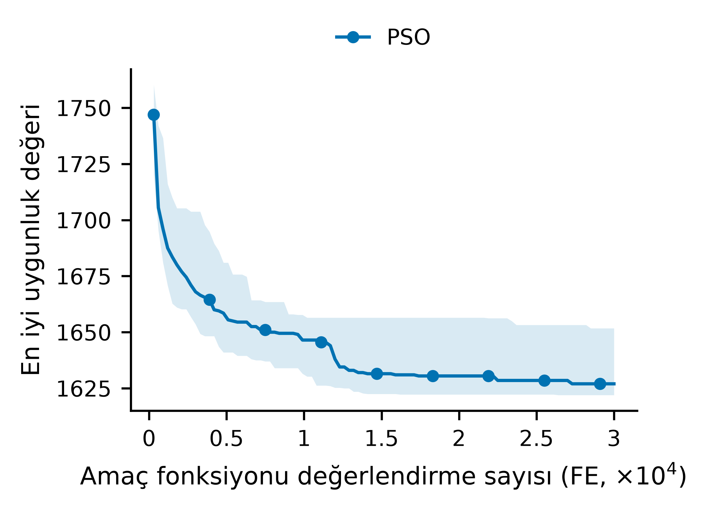

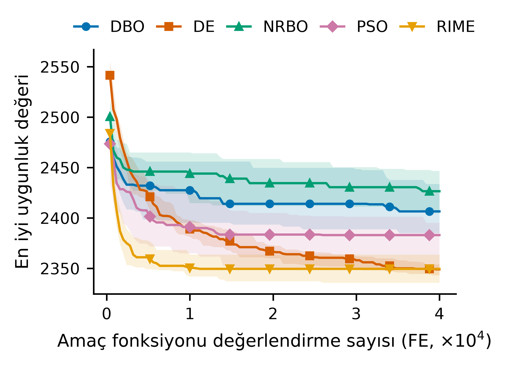

In ta001, DBO has a median of 1324 at half budget, while the other methods approach 1297 earlier. DE continues to improve on ta021; RIME's median trajectory is nearly stationary by its recorded early checkpoint. The curves do not establish causal superiority of individual operators.

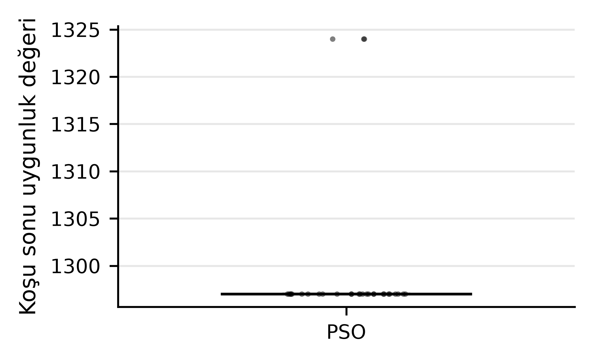

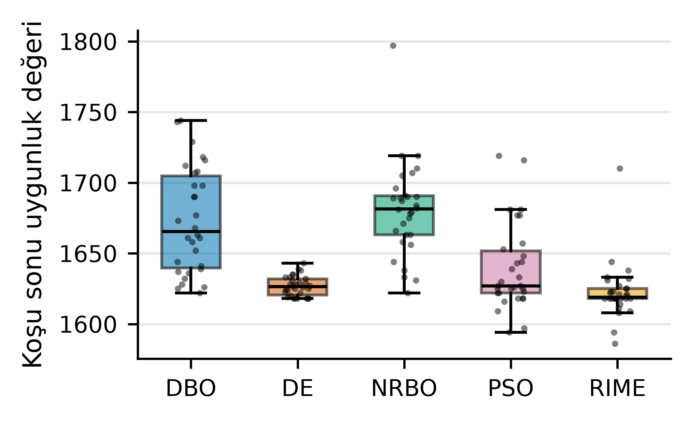

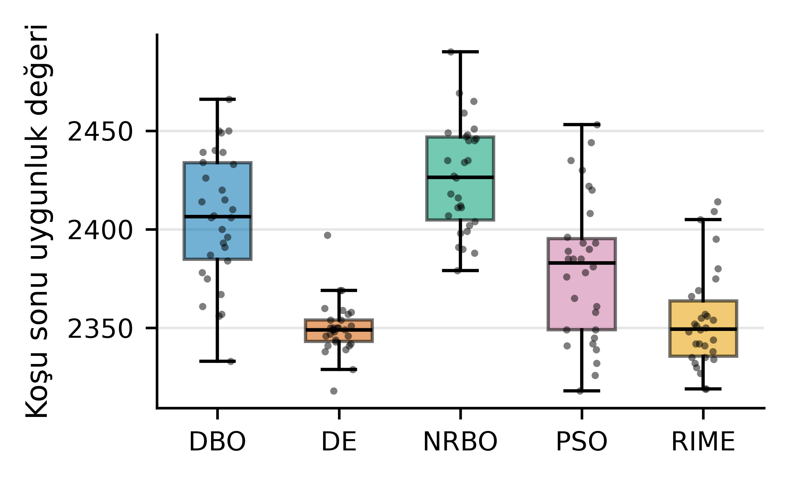

Dispersion and median performance provide complementary evidence. In particular, lower variance around a poor solution must not be interpreted as higher-quality optimization.

### 3.3. Statistical comparisons

**Tables 7–9. Two-sided Wilcoxon rank-sum and Holm-adjusted pairwise analyses.**

**ta001:**

<!-- data:wilcoxon_ta001 -->
| Comparison | z | p-value | p (Holm) | Result |
| --- | --- | --- | --- | --- |
| DBO – DE | 1.722 | 0.085 | 0.34 | = |
| DBO – NRBO | 0.6357 | 0.525 | 0.8238 | = |
| DBO – PSO | 0.8205 | 0.4119 | 0.8238 | = |
| DBO – RIME | 1.382 | 0.1669 | 0.5006 | = |
<!-- /data:wilcoxon_ta001 -->

**ta011:**

<!-- data:wilcoxon_ta011 -->
| Comparison | z | p-value | p (Holm) | Result |
| --- | --- | --- | --- | --- |
| RIME – DBO | -5.729 | 1.01e-08 | 3.031e-08 | + |
| RIME – DE | -2.58 | 0.009883 | 0.01219 | + |
| RIME – NRBO | -5.973 | 2.331e-09 | 9.322e-09 | + |
| RIME – PSO | -2.743 | 0.006097 | 0.01219 | + |
<!-- /data:wilcoxon_ta011 -->

**ta021:**

<!-- data:wilcoxon_ta021 -->
| Comparison | z | p-value | p (Holm) | Result |
| --- | --- | --- | --- | --- |
| DE – DBO | -5.847 | 4.998e-09 | 1.499e-08 | + |
| DE – NRBO | -6.594 | 4.286e-11 | 1.714e-10 | + |
| DE – PSO | -3.164 | 0.001557 | 0.003114 | + |
| DE – RIME | -0.02957 | 0.9764 | 0.9764 | = |
<!-- /data:wilcoxon_ta021 -->

The ta001 reference is DBO due to the prespecified alphabetical tie rule among equal median Cmax values. Its four comparisons do not reach adjusted significance. Ta011 shows RIME favored against all four recorded alternatives. In ta021, DE differs from DBO, NRBO and PSO; DE versus RIME does not meet the 0.05 threshold. A non-significant test is not evidence of equivalence.

**Table 10. Friedman statistics and post-hoc Nemenyi critical-difference thresholds.**

<!-- data:friedman -->
| Instance | Friedman statistic | p | Blocks | Method | CD |
| --- | --- | --- | --- | --- | --- |
| ta001 | 11.656442 | 0.0200975631331 | 30 | 5 | 1.113701 |
| ta011 | 55.899160 | 2.10520296168e-11 | 30 | 5 | 1.113701 |
| ta021 | 70.533333 | 1.75141438413e-14 | 30 | 5 | 1.113701 |
<!-- /data:friedman -->

**Tables 11–13. Average Friedman ranks for each benchmark.**

**ta001:**

<!-- data:ranks_ta001 -->
| Algorithm | Mean Friedman rank | Overall rank |
| --- | --- | --- |
| DE | 2.7 | 1.0 |
| RIME | 2.85 | 2.0 |
| PSO | 3.0 | 3.0 |
| NRBO | 3.067 | 4.0 |
| DBO | 3.383 | 5.0 |
<!-- /data:ranks_ta001 -->

**ta011:**

<!-- data:ranks_ta011 -->
| Algorithm | Mean Friedman rank | Overall rank |
| --- | --- | --- |
| RIME | 1.733 | 1.0 |
| DE | 2.367 | 2.0 |
| PSO | 2.667 | 3.0 |
| DBO | 4.05 | 4.0 |
| NRBO | 4.183 | 5.0 |
<!-- /data:ranks_ta011 -->

**ta021:**

<!-- data:ranks_ta021 -->
| Algorithm | Mean Friedman rank | Overall rank |
| --- | --- | --- |
| RIME | 1.8 | 1.0 |
| DE | 1.867 | 2.0 |
| PSO | 2.933 | 3.0 |
| DBO | 3.833 | 4.0 |
| NRBO | 4.567 | 5.0 |
<!-- /data:ranks_ta021 -->

**Table 14. Mean-rank pairs exceeding the Nemenyi critical difference.**

<!-- data:nemenyi -->
| Instance | Method pairs exceeding CD |
| --- | --- |
| ta001 | Yok |
| ta011 | DBO / DE; DBO / PSO; DBO / RIME; DE / NRBO; NRBO / PSO; NRBO / RIME |
| ta021 | DBO / DE; DBO / RIME; DE / NRBO; NRBO / PSO; NRBO / RIME; PSO / RIME |
<!-- /data:nemenyi -->

All three Friedman omnibus p-values are below 0.05, so a CD diagram is available for each. No pair exceeds the Nemenyi CD in ta001 even though the omnibus test is significant. RIME–DE does not cross the Nemenyi threshold in ta011 although the separate rank-sum/Holm table reports significance; the tests use different comparison families and blocking assumptions. DE–RIME is not separated in ta021 in either analysis.

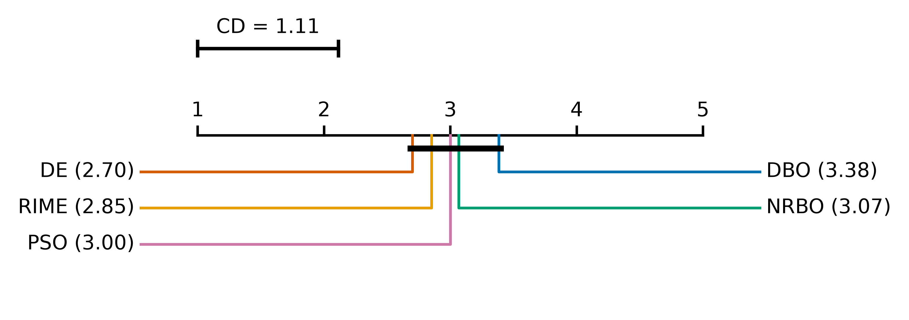

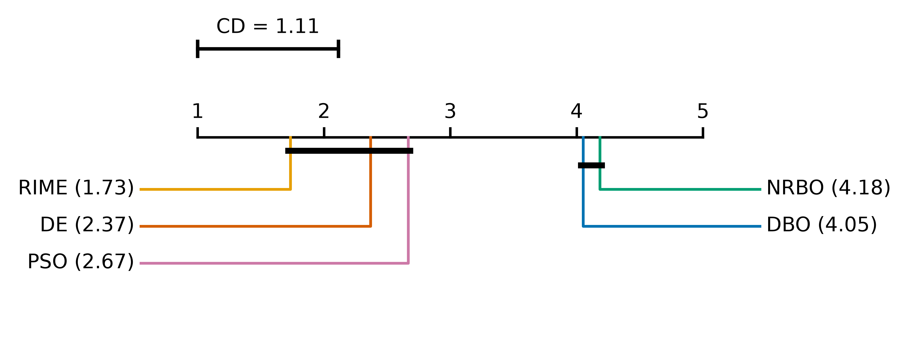

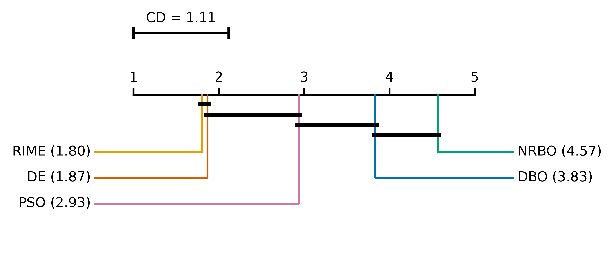

### 3.4. Best schedules and independent reconstruction

Every global minimum across the 450 final runs is recorded below, including the DE/PSO tie in ta021. The reported best order is selected by lowest run number and then alphabetical algorithm name when needed.

**Table 15. Best runs, seeds, Cmax, RPD and one-based job permutations.**

<!-- data:best -->
| Instance | Method | Run | Seed | Cmax | RPD (%) | One-based permutation |
| --- | --- | --- | --- | --- | --- | --- |
| ta001 | DE | 30 | 2055 | 1288 | 0.782473 | 17 9 15 8 3 14 16 6 11 19 13 5 4 18 1 2 7 10 20 12 |
| ta011 | RIME | 25 | 2050 | 1586 | 0.252845 | 18 5 2 12 9 10 15 17 14 3 4 6 19 8 20 11 13 7 1 16 |
| ta021 | DE | 14 | 2039 | 2318 | 0.914236 | 16 18 8 13 9 14 15 10 1 20 17 11 5 6 12 7 2 4 3 19 |
| ta021 | PSO | 17 | 2042 | 2318 | 0.914236 | 16 8 7 12 18 15 13 9 6 10 11 5 20 14 2 4 17 1 3 19 |
<!-- /data:best -->

The selected solutions were independently reconstructed without importing the production PFSP objective. Start/finish times satisfy the job precedence and machine non-overlap constraints, and the reconstructed makespans are 1288, 1586 and 2318.

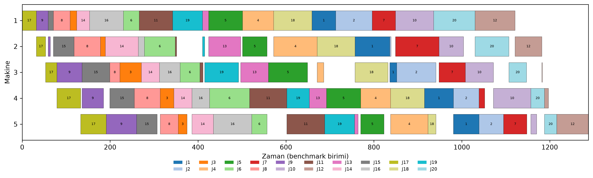

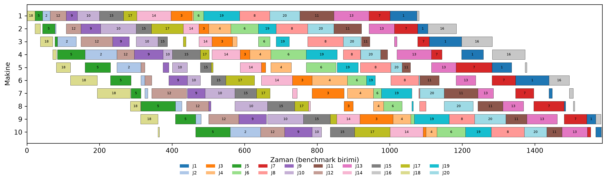

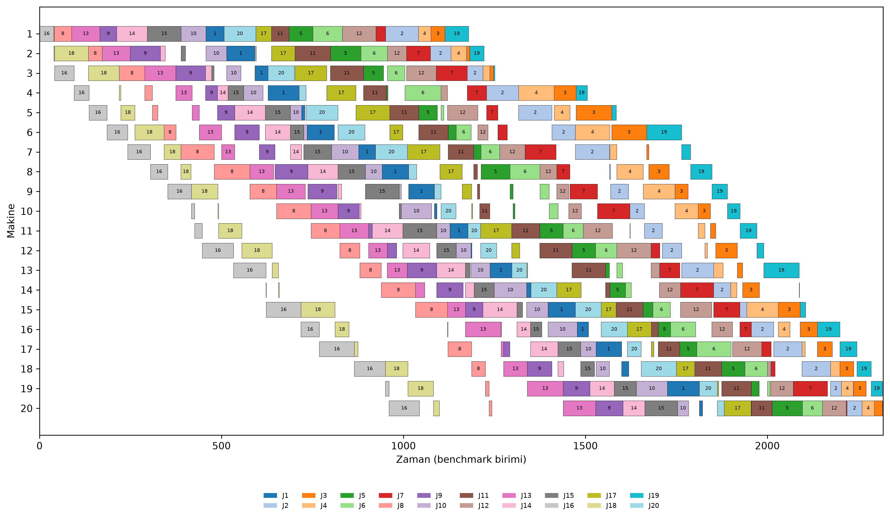

The [schedule-verification record](support/final_best_schedules.md) contains exact one-based permutations, independent verifier calls and operation-level schedule CSVs. Benchmark processing-time units are not assumed to be seconds.

### 3.5. Computational cost, limitations and discussion

**Table 16. Measured algorithm time per run; runtime belongs to the recorded environment.**

<!-- data:runtime -->
| Instance | Method | Mean time (s) | Time SD (s) |
| --- | --- | --- | --- |
| ta001 | DBO | 1.508162 | 0.037801 |
| ta001 | DE | 2.076895 | 0.031825 |
| ta001 | NRBO | 2.863740 | 0.074990 |
| ta001 | PSO | 1.609686 | 0.038811 |
| ta001 | RIME | 1.935841 | 0.059800 |
| ta011 | DBO | 3.489948 | 0.163062 |
| ta011 | DE | 4.307472 | 0.087779 |
| ta011 | NRBO | 5.353418 | 0.087068 |
| ta011 | PSO | 3.538647 | 0.039635 |
| ta011 | RIME | 3.989742 | 0.043880 |
| ta021 | DBO | 7.685562 | 0.098961 |
| ta021 | DE | 8.783263 | 0.121038 |
| ta021 | NRBO | 10.173185 | 0.053443 |
| ta021 | PSO | 7.879378 | 0.164444 |
| ta021 | RIME | 8.528509 | 0.118686 |
<!-- /data:runtime -->

DBO has the lowest mean runtime in each of the three recorded benchmarks, while NRBO is the slowest. Equal FE controls the number of objective calls but not operator costs, Python/NumPy overhead, memory behavior, runtime variability or machine load. NEH timing was recorded in a different Ubuntu CI environment and is not used for a speed ratio.

The experiment comprises only three 20-job Taillard instances and fixed algorithm settings; other sizes, machines, parameter tuning budgets and encoding choices were not evaluated. Repeated permutations were not explicitly counted. Ties in discrete Cmax results and the data-driven rank-sum reference constrain inferential strength. The strongest empirically supported conclusion is that relative ranking depends on the benchmark and the metric (best run, median, dispersion or runtime), not that one optimizer always dominates. Comparisons to hybrid and learning-based literature must account for training costs, local searches and differing budgets ([Tsiftsoglou et al., 2026](#ref-L10); [Li et al., 2024](#ref-L11); [Cáceres-Gelvez et al., 2026](#ref-L12)).

## 4. Conclusion

A fixed representation and equal objective-evaluation budgets allowed five continuous metaheuristics to be compared on three PFSP instances over 450 recorded runs. DE achieved the best observed Cmax in ta001, RIME in ta011, and DE/PSO tied in ta021. Results from sample distributions, post-hoc comparisons and a classical NEH baseline qualify the interpretation of isolated minima. The exact experimental revision, seeds, algorithm settings and raw outcomes are recorded to support reproduction. Future work should expand the benchmark family, assess ties and paired-seed sensitivity, quantify repeated permutations and compare local-search hybrids under explicit FE accounting. Submission remains conditional on author confirmation and an independent scientific review.

## Declarations

**Author contributions (draft, pending author approval).** Abdullah ELEN: Supervision [confirm]. Muhammed YILMAZ: Project administration, RIME software, writing review. Burak Münteha ELLİK: DBO/NRBO software and methodology. Şeref TEKMAN: PFSP/DE/NEH methodology and data curation [confirm actual delegation]. Tarık KARAOĞLAN: Experiment runner, formal analysis and validation. Bilal Erkan TAŞKIN: Literature, manuscript integration and visualization. Individual CRediT roles, final order and corresponding author must be approved by each contributor and advisor.

**Data and code availability.** [Repository: PFSP](https://github.com/mamyylmz/-Akis_Tipi_Cizelgeleme); experiment revision `73ce39c78a6263ce6f252267edeff0515157aca1`. Manifest, raw CSVs, SHA-256 verification and schedule reconstructions are linked in the repository. A permanent archive DOI, licensing and sharing permission are **[TO BE CONFIRMED]**.

**Conflict of interest and funding.** Neither a no-conflict statement nor a no-external-funding statement has been signed off by all authors. Both are **[AUTHOR CONFIRMATION REQUIRED]**.

**Ethical permissions.** This study analyzes public numeric benchmark instances, without human or animal participants or personal records. Whether an explicit exemption statement is needed under journal policy is **[ADVISOR CONFIRMATION REQUIRED]**.

**AI-assisted preparation.** The role of ChatGPT/Codex is disclosed under Materials and Methods. All results, source identities, contribution statements and ethics disclosures remain the responsibility of human authors. Full tool-use inventory **[AUTHOR CONFIRMATION REQUIRED]**.

## References

References are ordered alphabetically by author surname. Bibliographic identifiers and DOIs follow the documented source audit; this review did not independently access every full paper. Access limitations concerning NEH, DBO and NRBO are retained. The Shi–Eberhart citation follows the [PSO method record](method_pso.md).

Bean, J. C. (1994). Genetic algorithms and random keys for sequencing and optimization. *ORSA Journal on Computing, 6*(2), 154–160. [DOI](https://doi.org/10.1287/ijoc.6.2.154)

Cáceres-Gelvez, S., Dang, T. H., & Letchford, A. N. (2026). MIP-based local search for permutation flowshop scheduling with makespan objective. *Computers & Operations Research, 186*, 107309. [DOI](https://doi.org/10.1016/j.cor.2025.107309)

Gmys, J. (2022). Exactly solving hard permutation flowshop scheduling problems on peta-scale GPU-accelerated supercomputers. *INFORMS Journal on Computing, 34*(5), 2502–2522. [DOI](https://doi.org/10.1287/ijoc.2022.1193)

Kennedy, J., & Eberhart, R. (1995). Particle swarm optimization. *Proceedings of ICNN’95 – International Conference on Neural Networks*, 4, 1942–1948. IEEE. [DOI](https://doi.org/10.1109/ICNN.1995.488968)

Li, L., Liang, S., Zhu, Z., Ding, C., Zha, H., & Wu, B. (2024). Learning to optimize permutation flow shop scheduling via graph-based imitation learning. *Proceedings of the AAAI Conference on Artificial Intelligence, 38*(18), 20185–20193. [DOI](https://doi.org/10.1609/AAAI.v38i18.29998)

Nawaz, M., Enscore, E. E., Jr., & Ham, I. (1983). A heuristic algorithm for the m-machine, n-job flow-shop sequencing problem. *Omega, 11*(1), 91–95. [DOI](https://doi.org/10.1016/0305-0483(83)90088-9)

Shi, Y., & Eberhart, R. (1998). A modified particle swarm optimizer. *Proceedings of the 1998 IEEE International Conference on Evolutionary Computation*, 69–73. [DOI](https://doi.org/10.1109/ICEC.1998.699146).

Sowmya, R., Premkumar, M., & Jangir, P. (2024). Newton-Raphson-based optimizer: A new population-based metaheuristic algorithm for continuous optimization problems. *Engineering Applications of Artificial Intelligence, 128*, 107532. [DOI](https://doi.org/10.1016/j.engappai.2023.107532)

Storn, R., & Price, K. (1997). Differential evolution – A simple and efficient heuristic for global optimization over continuous spaces. *Journal of Global Optimization, 11*(4), 341–359. [DOI](https://doi.org/10.1023/A:1008202821328)

Su, H., Zhao, D., Heidari, A. A., Liu, L., Zhang, X., Mafarja, M., & Chen, H. (2023). RIME: A physics-based optimization. *Neurocomputing, 532*, 183–214. [DOI](https://doi.org/10.1016/j.neucom.2023.02.010)

Taillard, E. (1993). Benchmarks for basic scheduling problems. *European Journal of Operational Research, 64*(2), 278–285. [DOI](https://doi.org/10.1016/0377-2217(93)90182-M)

Tsiftsoglou, M., Marinakis, Y., & Marinaki, M. (2026). Optimizing the permutation flowshop scheduling problem with an improved sparrow search algorithm. *Algorithms, 19*(4), 283. [DOI](https://doi.org/10.3390/a19040283)

Xue, J., & Shen, B. (2023). Dung beetle optimizer: A new meta-heuristic algorithm for global optimization. *The Journal of Supercomputing, 79*, 7305–7336. [DOI](https://doi.org/10.1007/s11227-022-04959-6)

## Reproduction and supplementary material

The comparison uses seeds 2026 through 2055 inclusive. In a separate clean checkout of experiment revision `73ce39c78a6263ce6f252267edeff0515157aca1`, use `python src/main.py --runs 30`. The existing committed outputs are verified non-destructively with `python tools/check_experiment_outputs.py --raw-dir results/raw --runs 30 --seed-base 2026` and `python -B tools/prepare_paper_assets.py --check`. For the independent schedule reconstruction, use the commands in [final_best_schedules.md](support/final_best_schedules.md). Numerical tables have not been retyped or adjusted by hand.
