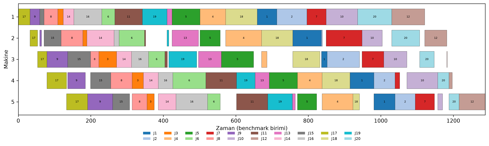
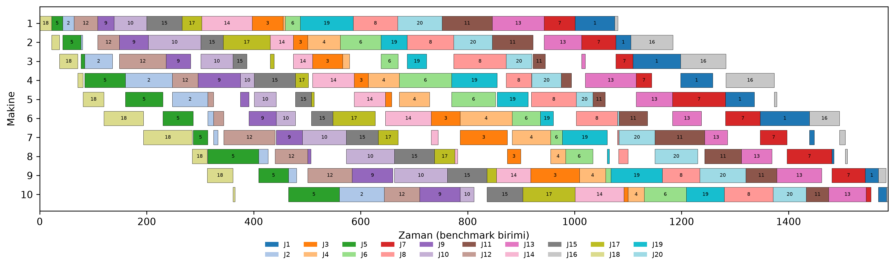
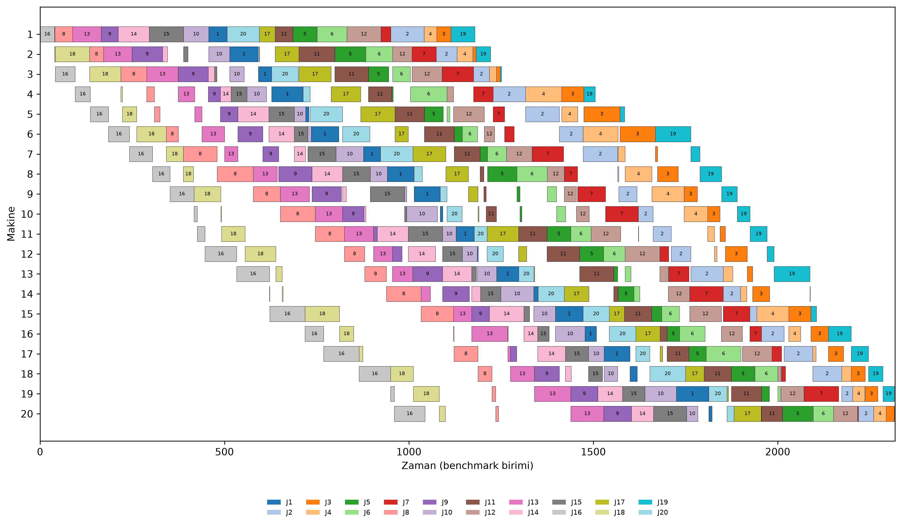

# Final en iyi çözümler ve bağımsız zaman çizelgeleri

Kaynak: final 450 koşu; deney commit'i `73ce39c78a6263ce6f252267edeff0515157aca1`. En küçük Cmax seçilir; eşitlikte en küçük run, sonra alfabetik algoritma adı kullanılır. Aşağıda bütün minimum eşitlikleri listelenmiştir. Zamanlar yalnız bağımsız verifier'dan üretilir. Bu sayısal kontrol, ekip bağımsız inceleme/onayının yerine geçmez.

<!-- data:best -->
| Örnek | Yöntem | Run | Seed | Cmax | RPD (%) | Permütasyon (1 tabanlı) |
| --- | --- | --- | --- | --- | --- | --- |
| ta001 | DE | 30 | 2055 | 1288 | 0.782473 | 17 9 15 8 3 14 16 6 11 19 13 5 4 18 1 2 7 10 20 12 |
| ta011 | RIME | 25 | 2050 | 1586 | 0.252845 | 18 5 2 12 9 10 15 17 14 3 4 6 19 8 20 11 13 7 1 16 |
| ta021 | DE | 14 | 2039 | 2318 | 0.914236 | 16 18 8 13 9 14 15 10 1 20 17 11 5 6 12 7 2 4 3 19 |
| ta021 | PSO | 17 | 2042 | 2318 | 0.914236 | 16 8 7 12 18 15 13 9 6 10 11 5 20 14 2 4 17 1 3 19 |
<!-- /data:best -->

## ta001

Seçim: DE, run 30, seed 2055. Bağımsız Cmax=1288; 100 işlem; makine çakışması=0; iş önceliği ihlali=0.

[Verifier zaman tablosu](schedule_ta001.csv) · [Ham koşular](../../results/raw/ta001/DE.csv)



```powershell
python tools/verify_final_schedule.py --instance ta001 --permutation "17 9 15 8 3 14 16 6 11 19 13 5 4 18 1 2 7 10 20 12" --expected-cmax 1288
```


## ta011

Seçim: RIME, run 25, seed 2050. Bağımsız Cmax=1586; 200 işlem; makine çakışması=0; iş önceliği ihlali=0.

[Verifier zaman tablosu](schedule_ta011.csv) · [Ham koşular](../../results/raw/ta011/RIME.csv)



```powershell
python tools/verify_final_schedule.py --instance ta011 --permutation "18 5 2 12 9 10 15 17 14 3 4 6 19 8 20 11 13 7 1 16" --expected-cmax 1586
```


## ta021

Seçim: DE, run 14, seed 2039. Bağımsız Cmax=2318; 400 işlem; makine çakışması=0; iş önceliği ihlali=0.

[Verifier zaman tablosu](schedule_ta021.csv) · [Ham koşular](../../results/raw/ta021/DE.csv)



```powershell
python tools/verify_final_schedule.py --instance ta021 --permutation "16 18 8 13 9 14 15 10 1 20 17 11 5 6 12 7 2 4 3 19" --expected-cmax 2318
```


Yeniden üretim: `python -B tools/prepare_paper_assets.py --generate`. Bu komut yalnız bu özet, üç zaman CSV'si ve üç Gantt PNG'sini yazar. Ham deney CSV'leri ve kabul kayıtları değiştirilmez.
